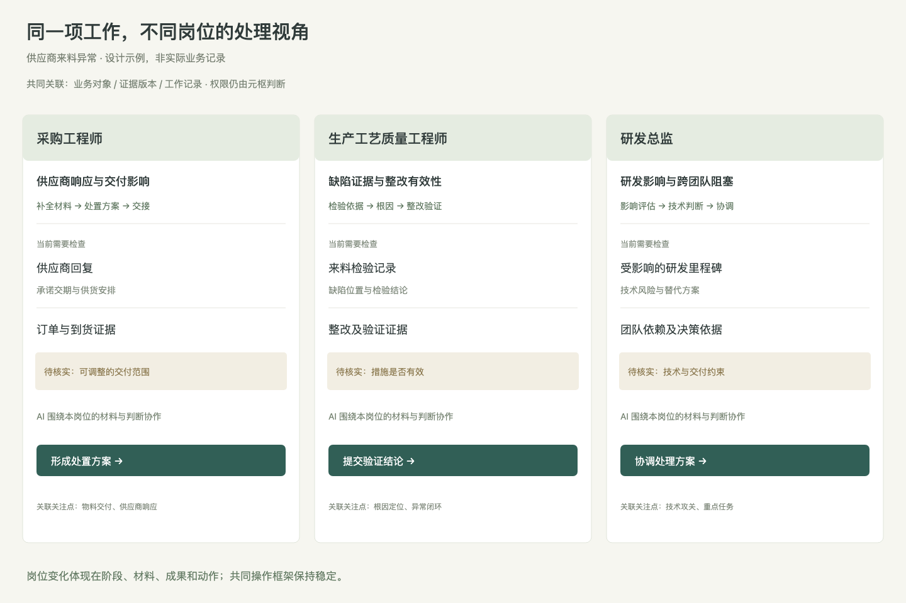
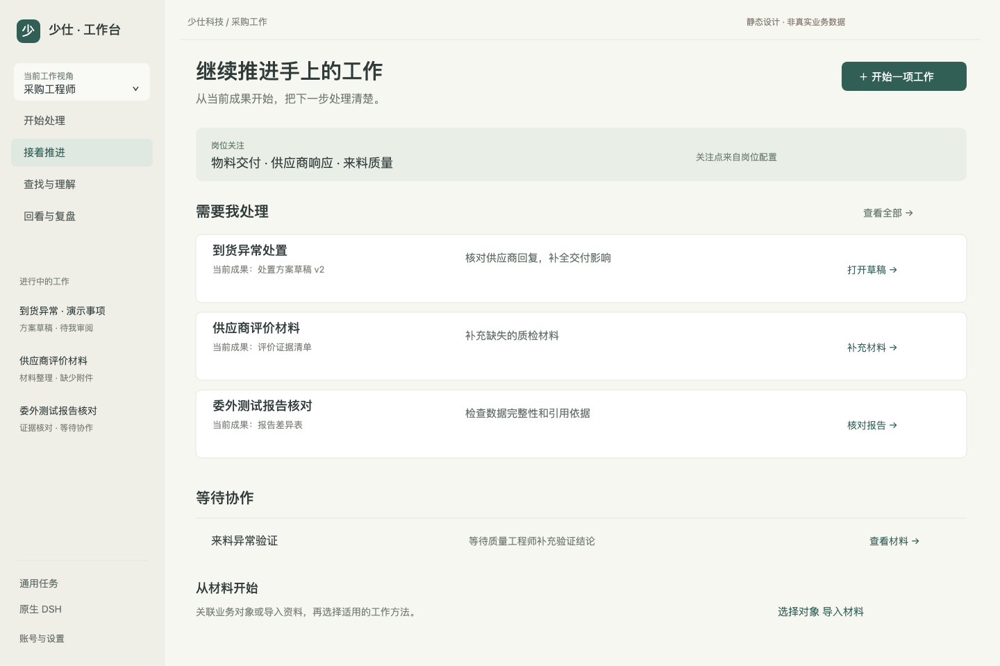
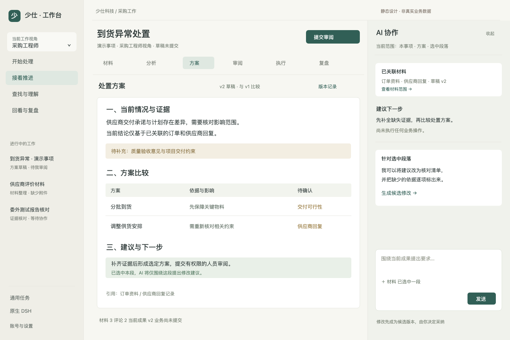
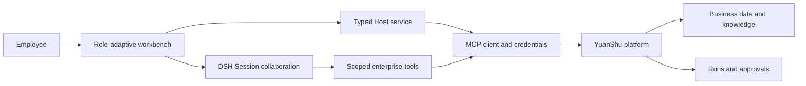

# Shaoshi DSH workbench: development design

English | [中文](design.zh.md)

## Summary

After sign-in, employees enter a role-specific personal assistant. It brings authorized YuanShu changes, pending work, and upcoming commitments to each employee with a source, reason, and suggested action. Employees use DSH for daily work, collaboration, and AI-assisted results, then use YuanShu capabilities within their authorization. The interface adapts priorities by role while retaining a common workflow. This document covers product scope, video references, role adaptation, MCP integration, code reuse, and acceptance; prototype data does not represent a live business connection.

## Table of contents

- [1. Product and scope](#product)
- [2. Video reference and existing implementation](#evidence)
- [3. Role adaptation](#roles)
- [4. Information architecture](#navigation)
- [5. Home and work detail](#screens)
- [6. Representative workflows](#journeys)
- [7. Visuals, responsive layout, and states](#visual)
- [8. Domain model and state ownership](#domain)
- [9. Plugin and client architecture](#architecture)
- [10. Business APIs, MCP, and DSH tools](#mcp)
- [11. AI methods and context](#ai)
- [12. Execution, approval, and recovery](#execution)
- [13. Identity, data, and permissions](#identity)
- [14. Branch strategy and reuse](#reuse)
- [15. Development and acceptance](#delivery)
- [16. Testing, quality, and observability](#quality)
- [Further exploration](#references)
- [Dev Note](#dev-note)

## 1. Product and scope

For this project, DSH means dedicated client software for Shaoshi employees. YuanShu provides enterprise identity, business objects, knowledge, ontology, professional capabilities, workflow execution, and approvals. DSH provides the employee workspace, AI collaboration, and result handling, connected through Host-side MCP. The initial design targets desktop work while retaining Web access; a separately branded installer requires its own packaging, signing, and update validation.

| Item | Design requirement | Initial scope |
|---|---|---|
| Entry | Connect authenticated identity, tenant, role, and personal assistant | Open the assistant inbox by default; retain role charts and general DSH tasks |
| Role adaptation | Adapt entry points, materials, steps, results, and actions | Validate two substantially different roles, selected by business owners |
| Complete workflow | Start with materials, draft, review, authorize execution, retrieve results | Complete at least one real business workflow |
| Business source | Use capabilities published by YuanShu | Show missing capabilities explicitly; label prototype data |
| Dedicated plugin | Independently compose, install, disable, and upgrade business capabilities | Keep Shaoshi business conditions out of the agent loop |

The first release does not cover every role and business process or introduce a general page builder. Role work packs use reviewed declarative configuration and a small set of built-in result renderers. The client exposes supported, authorized capabilities. YuanShu results determine business success; AI text cannot establish approval or successful submission.

After login, the Host resolves the current user, tenant, active positions, and grants before reading relevant changes, tasks, collaboration requests, and deadlines through permitted MCP capabilities. The assistant ranks each item by impact, deadline, owner, and work stage, then shows its source, reason, and next action. Missing data or authorization produces an explicit unavailable state rather than a fabricated alert. DSH provides Sessions, model collaboration, files, and task experience; YuanShu MCP provides authorized business reads and operations. State-changing actions identify their object, version, and effect and follow platform confirmation, approval, and result-verification rules.

## 2. Video reference and existing implementation

The reference is [“DeepSeek Harness can do this too? I turned it into a dedicated AI workbench”](https://www.bilibili.com/video/BV11XWa68ESR/). Review covered every-second subtitle OCR across the 16-minute-20-second video, with periodic full-screen text inspection; it did not rely on audio transcription. Timestamps aid navigation and OCR can contain errors. The proposal adopts the workflow organization and iteration method; Shaoshi must supply its actual business terminology, approval policy, and processes.

| Reference location | Organization in the video | Shaoshi DSH mapping |
|---|---|---|
| Around 01:20–01:40 | Start, continue, understand, and review entry points | Keep intent navigation; first surface role-relevant changes and work to continue |
| Around 02:40–03:20 | Parallel work threads, stage tabs, content in the center | Recoverable work items with central stages and results |
| Around 03:20 | Review comments address a segment and timestamp | Bind comments to result versions and exact fields, passages, or times |
| Around 10:40–11:00 | Test an interactive prototype with familiar work | Validate the workflow with real materials before expanding |
| Method across the video | Extract Skills, plan the whole workflow, prototype, develop, connect capabilities, compare accepted results | Drive development with role methods, accepted examples, and business acceptance |

Requirements from the follow-up video for scene memory, identity binding, progressive retrieval, and controlled Agent collaboration are maintained in [integration design section 7.1](integration-design.md#scene-continuity). These are proposed requirements; the current prototype does not resume business work across sessions.

Inspection on `feature/yuanshu-platform` covered `ui-yuanshu-chat`, `yuanshu-client`, `yuanshu-gateway`, `yuanshu-tool`, and related tests, including its role-workbench and MCP changes. `RoleWorkbench.tsx` already varies headlines, metrics, pending items, and records using platform roles, providing a useful data foundation. Its organization emphasizes briefings, metrics, and lists. This proposal makes ongoing work, staged results, and contextual collaboration the main path. These observations come from source inspection, not rendered-UI or business acceptance.

## 3. Role adaptation

Role adaptation spans the entire work process. YuanShu publishes role work packs declaring relevant business objects, priorities, work recipes, result views, and authorized actions. The client renders these declarations with stable components. Switching roles must produce observable content and action changes, beyond a greeting or metric label.

| Dimension | Platform provides | Client behavior |
|---|---|---|
| Entry | Pack version, authorized roles, visible work, ranking reasons | Identify the active role, prioritize personal actions, expose ranking reasons |
| Workflow | Recipe version, stages, prerequisites, completion evidence, participants | Show applicable stages and enable actions only when prerequisites hold |
| Content | Objects, field visibility, evidence, supported renderers | Display role-relevant columns, evidence, and result editors |
| AI collaboration | Method references, input/output requirements, tool scope, review criteria | Collaborate on the current work and selected material to produce reviewable results |
| Next action | Owner, allowed operations, permission and approval requirements | Show concrete verbs, execution scope, and who acts next |

Each position's typical scenarios combine confirmed KPIs, business objects, and daily tasks. The platform provides KPI definitions, current state, source evidence, freshness, trigger reasons, and related work; the client applies that position's work method. The assistant first checks material completeness, lists facts and gaps, proposes a next step, and prepares a reviewable result. Employees review it and decide whether to adopt it or start an authorized business operation. Business owners review KPI-to-scenario mappings; the client does not infer official alerts from position names or demonstration values.

For one illustrative incoming-material issue, procurement sees promised dates, supplier responses, and a handling draft; quality sees inspection results, defects, and correction validation; the R&D director sees development impact, alternatives, and coordination needs. Work identifiers and business objects remain linked, while fields, stages, and primary actions differ. This is an adaptation example, not an assertion about Shaoshi policy.

| Example role | Home priority | Central result | Primary action |
|---|---|---|---|
| Procurement | Commitments affecting delivery | Exception-handling draft and evidence | Add responses, compare options, submit for review |
| Process quality engineer | Missing causes or validation | Root-cause analysis and corrective evidence | Check inspections, request corrections, submit verification |
| R&D director | Blockers to development delivery | Impact analysis and option comparison | Request information, coordinate resources, handle authorized decisions |
| Project management | Items affecting milestones | Delivery-impact list | Check dependencies, propose adjustments, track results |

Users with several roles explicitly choose an active work view and can pin preferred roles. “All pending work” deduplicates actions assigned to the user. Changing views does not change identity, tenant, or authorization, recreate work, discard drafts, or rerun AI. YuanShu authorizes each request; hiding controls only communicates permissions.

Versioned packs associate roles, recipes, view identifiers, available actions, method references, and data scope. The client validates versions and renderer support, without executing platform-supplied JavaScript, arbitrary HTML, or styles. An unknown view produces a localized unsupported-view notice and upgrade guidance; a safe read-only summary does not imply full loading.

### 3.1 Read-only verification of Shaoshi positions and KPIs

On 2026-11-17, a read-only session confirmed that the supplied database server contains database `go_admin_kit`; the position tables are in its `public` schema. Shaoshi uses `tenant_id = 3` and tenant code `shaoshi`. Queries inspected table structures, positions, KPI configuration, and capability-directory metadata without writes or repository copies of connection details, passwords, employee names, or full KPI text.

| Observation | Result | Design consequence |
|---|---|---|
| Positions | 18 non-deleted positions, all with `status = 1` | Packs must support distinct R&D, manufacturing, quality, sales, and management work |
| Current KPIs | 200 non-deleted current rows, all `review_status = unreviewed` | Candidate priorities require business review before assessment or automatic decisions |
| Source modes | 45 auto, 101 semi, 54 manual | Distinguish connected calculations, missing evidence, and manual confirmation |
| Calculation and baseline | All 200 formulas empty; 33 unknown directions; 3 pending baselines | Do not infer formulas, denominators, directions, or baselines from prose; verify actual calculation capabilities through MCP |
| Holder groups | Process quality, procurement, and hardware each have two groups of ten | A position name alone cannot determine an individual's work view |
| Identifiers | 200 unique KPI UIDs; position/code repeats disappear when holder groups are included | Use platform-stable KPI identifiers rather than dropping duties by position/code deduplication |
| Position without KPIs | Project management exists without associated KPIs | Show work and role descriptions, label missing KPI configuration, and avoid zero scores or dead ends |

### 3.2 Work views derived from actual positions

The first two columns summarize position and KPI configuration; the last two propose views to validate with real work. KPIs identify responsibilities and connect them to evidence and action. Home does not display 200 metrics or mistake configured targets for achieved results.

| Actual position | Configured priorities | Proposed central work | Proposed primary action |
|---|---|---|---|
| Test engineer | Debugging issues, test archiving, test support | Test tasks, raw records, issue evidence, reports | Organize records, record issues, deliver reports |
| Process quality engineer | Process inspection, root cause, supplier correction | Exception analysis, process evidence, correction, validation | Analyze causes, request corrections, verify closure |
| Procurement engineer | Delivery, supplier response, incoming quality | Delivery, supplier evidence, exception proposals | Follow commitments, add evidence, submit proposals |
| Pilot-line manager | Product introduction, production plan, exception response | Introduction stages, trial issues, scheduling effects | Resolve blockers, coordinate resources, confirm stages |
| Motor engineer | Selection, control algorithms, integration, documentation | Design options, performance comparisons, verification | Compare options, analyze issues, update documents |
| Marketing manager | Intelligence, brand materials, channels, lead conversion | Marketing materials, campaign results, lead evidence | Organize intelligence, produce materials, advance leads |
| Sales manager | Customer projects, fulfillment, collections, reviews | Customer work, meeting notes, fulfillment evidence | Update opportunities, verify commitments, follow up |
| Department manager | Team goals, key customers, business and financing work | Priority work, decision materials, issue closure | Review progress, coordinate resources, decide |
| Brake-system engineer | Design delivery, trial issues, drawings, technical maintenance | Drawing versions, design notes, tests, change evidence | Review designs, resolve issues, publish documentation |
| Hardware engineer | Design, localization, reuse, reliability, cost | BOMs, design differences, reliability issues, verification | Compare selections, analyze corrections, submit review |
| HR manager | Hiring quality, training impact, collaboration, process efficiency | Hiring and training materials, process comparison, confirmations | Check evidence, organize evaluations, propose improvements |
| Embedded software engineer | Delivery, interfaces, diagnostics, issues, documentation | Requirements, interfaces, issue evidence, delivery materials | Analyze issues, check requirements, maintain documents |
| R&D director | Goals, technical problems, process, modeling, experimental data | R&D milestones, risks, technical work, reviewed results | Review technical decisions, resolve cross-team blockers |
| Assembly technician/storekeeper | Assembly, inspection, stock accuracy, issue response | Work orders, operation records, stock movements, exceptions | Record steps, reconcile materials, report exceptions |
| Equipment engineer | Availability, repairs, preventive maintenance, hazards | Equipment history, faults, plans, evidence | Record faults, perform maintenance, verify recovery |
| Quality engineer | Nonconformity review, quality control, improvement, archiving | Nonconformities, review evidence, actions, verification | Check evidence, review disposition, verify closure |
| Special-vehicle business president | R&D goals, technical issues, product milestones, business | Product and business impacts, dependencies, alternatives | Assess effects, allocate resources, track decisions |
| Project management | No configured KPIs | Plans, milestones, dependencies, responsibilities | Maintain plans, coordinate blockers, track delivery |

Prioritize procurement and process quality for a supplier-material exception, then test impact and coordination through the R&D director view. Actual positions and related KPIs support this proposal and expose role differences on one object. Business and platform owners still confirm workflow, reviewers, and writable actions. This pair is an implementation priority proposal; extend other positions through packs, and do not treat unobserved positions as configured facts.

### 3.3 From role configuration to executable work packs

The YuanShu publication layer combines position identity and descriptions from `sys_positions`, priorities and evidence requirements from `sys_position_kpis`, and assignments, primary positions, validity, and status from `sys_user_positions`. `sys_position_default_roles` can associate positions with permission roles without replacing actual user authorization. Only the structures of these two association tables were inspected, not employee assignments or permission semantics. Position, assignment, and permission role remain distinct concepts, without string-based authorization inference.

The platform must explicitly map holder groups to the user or duty set. The client must not fuzzy-match employee names against `holder` or choose the first group. Packs retain stable KPI references, groups, versions, validity, and review status. Without an assignment, show shared position priorities and indicate that individual KPIs are unresolved, without automatically merging assessment scores.

Map KPIs to entry points through business review: priority, business objects and evidence, executable recipe, current work, results and verification. Show actual values, gaps, and alerts only when sources are connected, calculation definitions confirmed, and access authorized. Otherwise show missing-data, manual-confirmation, or unresolved-definition states. Source descriptions are not connector configuration, and an auto flag does not establish live automatic calculation.

Database inspection supports this design only. The deployed client does not connect directly to PostgreSQL or hold administrator credentials. YuanShu exposes authorized role, priority, metric-evidence, and pack projections through MCP, consumed by the Host under current user and tenant scope. Configuration corrections and KPI confirmation use platform administration rather than silent DSH writes to position tables.

## 4. Information architecture

Use an assistant inbox, role charts, ongoing work, and results with AI collaboration. The assistant inbox opens after sign-in; charts support metric investigation and comparison, while work detail contains materials, results, review, and execution. Roles determine data ranking and primary actions while control locations remain stable for collaboration across roles.

| Region | Content | Interaction rule |
|---|---|---|
| Upper left | Shaoshi identity, active role, My assistant, Position dashboard, and Start work | Switch roles; keep the assistant in a fixed entry point |
| Lower left | Ongoing work, favorites, recently opened | Show title, stage, and next actor; support search and archiving |
| Center header | Work title, status, owner, stages, related actions | Show authoritative status and freshness; label consequential actions explicitly |
| Center body | Assistant signals or work materials, results, reviews, and business outcomes | Show each signal's source, reason, owner, and actionable next step |
| Right | DSH collaboration, next step, selection, execution status | Collapsible; expose context scope and link execution to its original Run |
| Global entry | General tasks, native DSH, account and settings | Restore the same work, draft, and Session on return |

“Find and understand” searches knowledge and business objects; users can attach results to existing work or start a new item with an explicit recipe. “Review and learn” emphasizes completed results, adoption, and reusable methods. Charts appear when a role needs comparisons. Authorized diagnostics contain developer tools, MCP catalogs, and connection details.

The assistant inbox brings data to its employee and is not a tenant-wide dashboard. It reads changes and work visible to the current user and presents supporting evidence, freshness, related objects, next owner, and a suggested action together. Employees can open the item, confirm materials, or inspect role charts. Duplicate notices are grouped, expired or handled items are downgraded or closed, and every operation remains subject to YuanShu authorization.

## 5. Home and work detail

These static concepts support review of layout and the main workflow; they are not screenshots of a running plugin. Names, identifiers, materials, and business content are illustrative. Implementation uses DSH themes, components, and localization rather than copying concept pixel values into global constants.

The position dashboard shows metrics, trends, and role methods; it is an analysis destination from the assistant inbox rather than the default home. The assistant first presents role-filtered priorities, work requiring personal action, and upcoming commitments. Each item traces to an authorized source, explains why it appeared, and opens related work. An empty inbox says there are no confirmed new items instead of inserting synthetic alerts.

The assistant home also shows KPI scenarios and daily work for the active position. Each KPI scenario links a typical task, method, source materials, and deliverable; the assistant applies the method to organize evidence and prepare a draft for review. The daily list lets employees continue recurring position work with the assistant. Prototype charts, KPI values, and scenario mappings are demonstrations, not confirmed KPI definitions or live alerts.

The center of work detail supports inspecting, editing, and comparing results. The example stages “materials, analysis, proposal, review, execution, learning” are recipe-defined; they are not six mandatory stages for every role. Each active stage shows completion conditions, missing inputs, and ownership. Saved results or platform state determine completion.

The AI composer identifies its materials and active selection. Users select passages, table rows, or attachments for explanation, revision, or completion. AI edits first become comparable candidates that users accept wholly, accept partly, or reject. Business submission separately states the action, target, and effect; sending a chat message does not constitute approval.

Comments bind to a result version and a field, passage, page, or media timestamp. After edits, old comments retain their original location and version and indicate rechecking. Uncertain anchors are not guessed. Concurrent edits use version conditions; conflicts preserve local drafts and show differences.

## 6. Representative workflows

These examples test cross-role work, material handling, and authorized execution; they are not confirmed Shaoshi requirements. The first development phase replaces them with accepted real materials and an example of a satisfactory result.

### 6.1 Incoming-material exception across roles

Procurement starts from an exceptional order and associates inspection records, promised delivery, supplier responses, and delivery constraints. AI identifies missing inputs and produces a cited handling draft. The employee compares options, saves a selected version, and sends it to platform-designated reviewers. Quality checks defects and correction evidence; R&D management evaluates development impacts and coordination needs. Execution uses the approved version and retrieves the business outcome.

Acceptance focuses on distinct materials, fields, and actions for procurement and quality; no field leakage on role switches; explicit missing evidence; platform-enforced invalidation or renewed approval after approved content changes; and recovery of the original execution after refresh without duplicate operations.

### 6.2 Quality correction through causes and verification

A process quality engineer opens a quality issue. The center displays inspections, defects, cause analysis, supplier corrections, and verification evidence. AI distinguishes facts, hypotheses, and items requiring verification without inventing a root cause. The engineer submits correction comments and arranges or records verification. Closure requires platform-confirmed completion criteria and authorization. Root-cause timeliness and incoming-issue closure KPIs link to evidence, while actual assessment follows confirmed calculation definitions.

### 6.3 Knowledge answers as work materials

An employee selects a knowledge scope, asks about a product or business object, and receives a sourced answer, with unavailable or conflicting sources identified. The answer and source snapshot can be attached to work or continued with a selected recipe. Pure questions can use a separate Session without creating an approval workflow.

## 7. Visuals, responsive layout, and states

The visual direction follows the video's calm workspace: warm neutral surfaces, clear text, restrained semantic accents, and a generous result area. Content hierarchy and actions express role differences while branding, navigation positions, and components remain consistent. Light concepts establish direction; delivery validates both light and dark themes.

| Item | Design constraint |
|---|---|
| Space | Desktop reference proportions are roughly 220 left, flexible center, 320–380 right; prioritize results and resolve sizes through shared scales |
| Typography | Use system fonts and existing typography tokens; new feature weights stay at or below 500 with readable body and table text |
| Color and geometry | Use theme semantics, shared radii, and materials; distinguish selection, risk, gaps, and success with more than color |
| Density | Tables support comparison, documents support explanation; avoid one card per field |
| Width changes | Collapse AI into a drawer before navigation; use work, materials, and AI as single-region views on small screens |
| Overflow | Wrap titles; scroll tables locally or expose details; keep primary actions and focus reachable |
| Accessibility | Keyboard access, visible focus, named icons, announced states, contrast, and reduced motion |

Review covers loading, empty data, permission denial, expired authentication, platform outages, unsupported pack versions, pending approval, execution failure, unknown submission outcomes, draft conflicts, and read-only archives. Regional failures preserve loaded content and inputs with local recovery actions. Pending execution, approved, submitted, and completed have distinct labels rather than one generic processing state.

## 8. Domain model and state ownership

The design separates business work, AI conversations, and platform executions to prevent duplicate business operations on refresh, role changes, or retries. These are proposal terms, not changes to the current Session format.

| Concept | Meaning and relationships | Authority |
|---|---|---|
| Role work pack | Versioned role entry points, recipes, methods, and views | Published by YuanShu, support validated by the client |
| Work recipe | Method, stages, inputs, outputs, and review requirements; pinned for active work | Published by YuanShu and reviewed by business owners |
| Work item | Ongoing business objective, related objects, owner, results, and stage | YuanShu business records; aggregate operations require agreement |
| Session | AI collaboration history; a work item can have several explicitly purposed conversations | DSH Session storage, excluding platform secrets |
| Run / task_ref | One platform execution and its original reference; several can belong to one item | YuanShu; preserve references unchanged |
| Result version | Reviewable document, table, or attachment with sources and a version | Published results reside in platform-authorized storage; local drafts are labeled |
| Review and approval | Review provides comments; approval authorizes a state transition bound to an object and version | Platform determines approval authority and validity |

The platform owns business truth. DSH persists associations to Sessions, original task references, result references, and collaboration history. The client stores navigation, panel preferences, and recoverable drafts. Implementation follows existing storage and Session projection extension mechanisms; new persisted types, events, and compatibility promises require implementation review and persistence acknowledgements.

Offline access is limited to authorized cached data and drafts with source and freshness indicators. The first release does not queue automatic business writes. Reconnection checks identity, permission, object version, and original execution before continuation; expired cache does not enter new model requests. Recipe upgrades do not silently rearrange active stages; migration is explicit and explains effects.

## 9. Plugin and client architecture

The runnable UI prototype is [`yuanshu-workbench`](../../../packages/experimental/yuanshu-workbench/README.md), loaded through a standard bundle manifest, browser entry and DSH slots. Loading the plugin opens its fullscreen interface with only workbench navigation visible; the footer restores native DSH. All 18 verified positions plus an additional company management view have distinct charts, tasks, materials and methods. The company summary links operating, delivery, quality, supply and organizational risks to responsible positions; tasks, versions, calendar, team, notifications and materials are shared destinations. The return action uses the DSH layout service to restore the current conversation. The prototype has no platform connection and keeps demonstration records only in browser memory.

Maintain product composition, client experience, and Host business services separately while reusing MCP and identity foundations. The following package names are proposals and do not yet exist. Roles do not each get a package, and the design does not copy the DSH conversation interface.

| Proposed module | Responsibility | Constraint |
|---|---|---|
| `packages/client/ui-shaoshi-workbench` | Navigation, role views, stages, results, review, contextual collaboration | Components do not connect to remote MCP or import private React components from other plugins |
| `packages/yuanshu/yuanshu-workbench` | Work service definition, MCP provider, task recovery, typed remote access | Hide protocol and execution complexity without becoming a universal YuanShu passthrough |
| `packages/bundle/shaoshi-workbench` | Dedicated-profile plugins, branding, default layout | Preserve general Web defaults and use supported dsh launch paths |
| Reused YuanShu foundations | MCP connection, OAuth, credentials, discovery, resources, professional capabilities | Import selected files and verify dependencies instead of merging the feature branch |

Business components consume framework hooks, `useResource`, and store actions. Stores, resources, and services own subscriptions and requests. Identity, tenant, role, or work-version changes cancel prior requests and reject late responses by generation; read caches include full scope. Runtime validation applies to configuration, network responses, persisted data, and model input; typed same-process calls rely on TypeScript.

### 9.1 Technical prerequisite for the three-region layout

A global `main` panel on master does not automatically receive a Session. The existing right sidebar hides when a non-conversation global panel opens. Registering a new `main` therefore does not by itself deliver work in the center with chat on the right. `ui-conversation` offers a `conversation.content` factory, while conversation views and right-sidebar tabs are Session-scoped; composition needs validation.

P0 treats home and work detail separately: home uses a global entry, while work detail first tests a Session-bound work view, existing right-sidebar tabs, and public factories for collaboration. Validation must establish one active input owner, no recursive work-view mounting, and recovery of drafts and attachments with the same Session. If public extension points are insufficient, design a generic conversation-presentation extension before integrating business UI; do not bypass scoping, copy chat components, or add a separate right sidebar.

Manage registrations, listeners, and contributions through `ctx.effect()` or `ctx.on()`. On plugin disablement, tenant change, or Session disposal, stop consumers and asynchronous work before releasing connections and credential references. Do not leave polling, selected tools, or listeners behind. Service definition, MCP provider, and UI/Agent consumers form the complete capability; split further only when they evolve independently.

## 10. Business APIs, MCP, and DSH tools

The source-backed interface allocation is maintained in [the integration design](integration-design.md). YuanShu already provides a unified, user-scoped MCP service at `/api/v1/client/mcp`, including deterministic `workbench_*` reads for the UI. Keep HTTP for login, tenant bootstrap, files, health, and notification delivery; use MCP for governed workbench, knowledge, ontology, professional capability, and task operations. A tool is one operation, MCP is the discovery and invocation protocol, and a DSH-native tool is an optional task-shaped orchestration.

The integration document's exposure matrix is normative for this prototype: control-plane and transport operations stay HTTP; governed business capabilities use MCP Tools or Resources; DSH calls MCP Tools directly from the Host when a screen needs deterministic data, without asking a model to choose the call.

| Capability | Recommended interface | Shaoshi workbench use |
|---|---|---|
| Login, current user, tenant, active positions, grants, logout, and session renewal | YuanShu HTTPS API | Authenticate the employee before loading any tenant or position data. These endpoints and token rules still require confirmation from YuanShu owners. |
| Workbench bootstrap, position pack, reviewed KPI definitions, and bounded work records | YuanShu MCP `workbench_*` projections | Host calls the user-scoped service deterministically for the UI. Filter and authorize on the platform; do not add a duplicate REST facade. |
| Explicit user actions such as creating a work item, posting a group assignment, uploading evidence, or submitting an approval | Existing YuanShu API when the platform defines one; otherwise a narrowly scoped MCP operation | Start from a visible user action, validate current permissions, preserve the platform task reference, and support idempotent status lookup. Do not infer an endpoint from a database table. |
| Knowledge search, evidence retrieval, semantic business queries, cross-source analysis, metric reads, and governed metadata reads | MCP tools | Let the assistant select a bounded query or evidence operation from the employee's request and current work context. |
| SOPs, policy references, role guidance, and other read-oriented context | MCP resources where the platform exposes stable resources; otherwise MCP read tools | Load only relevant context. Return source identifiers and citations so the assistant can ground its answer. |
| Draft generation or preparation that combines several reads and DSH session context | DSH-native tool, optionally implemented as an orchestration over MCP tools | Offer the model one task-shaped operation rather than every low-level connector call. It must not claim a platform write succeeded. |
| Platform-side proposals, approvals, or other state changes initiated by an agent | A narrowly described MCP tool only when YuanShu exposes it; explicit API action for the UI | Require platform authorization and approval policy on every call. Show the exact target and effect before confirmation, then read the authoritative result. |

### What the database currently confirms

A read-only inspection of the supplied YuanShu database on 2026-11-17 found 18 active Shaoshi positions and 200 current position-KPI rows. All current KPI rows have `review_status = unreviewed`; the 18 positions include project management with no KPI rows. Treat these as configuration candidates, not approved scorecards or live measurements.

The database `mcp_tool_registry` has 47 active rows in the inspected snapshot. This table is not the complete client MCP catalog: the unified service also registers workbench, ontology, task, and published asset capabilities, while applying projection and per-call authorization. Registry metadata alone does not establish which operations are exposed to a particular employee, safe for a model, or usable by this tenant; discover capabilities after authentication and verify schemas, user grants, resource scope, and approval rules.

The tenant currently has two active DAG definitions, one knowledge collection, no tenant Agent definitions, and no tenant metric definitions in the inspected tables. These counts do not prove that no equivalent functionality is published elsewhere. In particular, database presence does not confirm a login API, employee task/calendar/group API, or live KPI query service. YuanShu must provide its API documentation, MCP endpoint and authorization details, and a redacted capability discovery result before those can be treated as available.

### Keep the layers distinct

| Term | Meaning here | Example |
|---|---|---|
| Business API | A typed, stable platform interface used by the application or another service | `GET current-user`, `GET my-tasks`, `POST submit-for-review` |
| MCP | A protocol for a client to discover and call server capabilities; a server may expose tools, resources, and prompts, and may internally use APIs, libraries, or direct application logic | Discover `knowledge.search`, then call it with the authorized collection and query |
| Tool | One named operation with a description and input/output schema that an AI model may be allowed to call | MCP-published `knowledge.search`, or a DSH-local `prepare_supplier_exception_draft` |
| DSH-native tool | A model-facing operation registered in DSH's scoped tool registry; it can call local services, YuanShu APIs, or MCP tools | Combine authorized reads and selected attachments into a cited draft |

MCP does not automatically wrap every REST endpoint, and an API is not automatically safe to expose as a model tool. MCP tool annotations and descriptions help clients understand use but do not replace YuanShu authorization, tenant isolation, or human approval. Every business read and write must be authorized by YuanShu for the current user; DSH hiding a button is only a presentation choice.

### Design rules for the integration

Keep control-plane UI operations on typed APIs and governed business reads/writes on the existing MCP service. Keep model-facing Tools task-focused, bounded, and explicit about read/write effects. Implement a DSH orchestration Tool only when it removes meaningful multi-call reasoning or supplies DSH-owned Session behavior; do not create a thin duplicate for every MCP Tool. Reuse the same YuanShu business rules and authorization whether an operation enters through an API or MCP. Require idempotency and a status lookup for writes whose network outcome can be unknown. Never send employee passwords to a model or store them in a Session.

The database inventory is an implementation-planning observation, not an API or permission contract. YuanShu and DSH owners must confirm endpoint schemas, pagination, token audience and renewal, capability versions, conditional updates, error categories, idempotency, audit records, and recovery before live integration.

## 11. AI methods and context

Each recipe contains a testable method: applicability, inputs, key judgments, steps, result requirements, citation rules, review criteria, prohibited assumptions, and an accepted example. Business owners confirm methods and the platform publishes versions. DSH loads the portions relevant to current work rather than placing all enterprise data and MCP tools in a prompt.

The primary interaction is an active work loop: a platform notice or scheduled checkpoint wakes the role Agent; it evaluates relevance, gathers evidence through bounded MCP Tools, loads the applicable method, prepares a reviewable result, requests human confirmation for consequential actions, executes through the platform, and tracks the original task to a verified result. Event delivery and durable cursors are platform responsibilities; MCP catalog subscriptions do not replace a business event feed.

Model context expands progressively through authorized tenant and user scope, work and recipe, stage, selected material, and tools needed now. Knowledge, attachments, and tool results are data, not instructions to expand permissions or change system rules. Role information, selections, citations, and tool results reaching a model request must be reconstructable from Session logs; secrets stay outside logs.

Employees can inspect AI sources and intended actions. AI first produces drafts or proposals; explicit business operations handle sending, business changes, and approval submission. Model connectivity and YuanShu capability connectivity have separate states. Learning informs method versions; comments and incidental conversation do not automatically become company-wide rules.

## 12. Execution, approval, and recovery

The client distinguishes preparing, accepted, running, waiting for input or approval, and terminal states. Task references drive recovery; neither a network error nor AI text establishes that a business operation did not occur.

1. The user selects a concrete action. The Host validates identity, permission, object and result versions and presents affected objects and approval requirements.
2. Submit with platform-supported idempotency. Persist the task reference association immediately on receipt and use it for later queries and operations.
3. A timeout before receiving a reference becomes an unknown submission outcome. Reconcile through a platform query or original idempotency key and block duplicate submission until resolved.
4. Pending approval or `input_required` retains the original Run and shows required input, authorized actors, and allowed operations without starting a replacement.
5. Refresh or reconnect reads original task state first. If event resumption is unavailable, query state and results without assuming exactly-once event delivery.
6. Show canceled only after platform confirmation and show the relevant completion state only with result and business-write evidence.

Read retries can follow configured limits. Business rejection, permission denial, invalid input, and unknown outcomes do not trigger automatic re-execution. Structured errors provide localized recovery guidance while preserving results and access to the original task and diagnostic identifier. When reconciliation is unavailable, direct verification to business or platform owners rather than offering an ordinary re-execution retry button.

## 13. Identity, data, and permissions

Tenant, user, role, and work scope determine visibility. YuanShu authorizes access, the Host enforces scope, and the UI communicates availability. A tenant switch invalidates prior context and reacquires work packs and grants rather than merely changing a filter.

Reuse OAuth discovery, PKCE, issuer/resource validation, scoped credentials, and revocation, with dedicated-client session validation. Secrets remain in Host credentials. Browsers do not call remote MCP directly or write secrets into Sessions, attachments, or diagnostics. Existing localStorage login-token handling requires explicit review and a replacement plan rather than wholesale reuse as the new baseline.

Isolate cache by tenant, user, grant scope, role, work, and version. Expired authorization stops reads and model-context injection; logout clears protected cache. Retrieve and export files under platform authorization. Shaoshi and platform owners configure redaction, retention, allowed model services, and cross-device drafts rather than hardcoding these in frontend code.

## 14. Branch strategy and reuse

The `dev` branch exists in a separate worktree based on `master`; this task did not modify the original feature checkout. This deliverable contains design and concepts only, with no imported feature code. Future imports select files, dependencies, and tests from the table rather than merging feature history, which includes unrelated UI, SDK, test, and vendor work.

Paths below identify candidates in the original feature checkout and are not claimed to exist in dev. At final verification on 2026-11-16, the source branch contained committed role-workbench and MCP-hardening changes with a clean working directory. Record the source inventory before importing and validate on dev.

| Source | Choice | Required handling |
|---|---|---|
| `packages/yuanshu/yuanshu-client/src/mcp.ts` | Primary reuse | Import MCP/OAuth/discovery/resource/call foundations; review concurrent catalog changes, dependencies, and errors |
| `packages/yuanshu/yuanshu-client/src/index.ts` | Selective reuse | Keep needed projections and types, verify tools and fields, avoid implicit legacy HTTP fallback |
| `packages/yuanshu/yuanshu-gateway` | Reuse with audit | Same-origin proxy, authorization, scoped credentials; inspect identity handling and disposal for all routes |
| `packages/yuanshu/yuanshu-tool/src/enterprise.ts` | Reuse patterns and implementation | Session-scoped grants, progressive discovery, resources, lifecycle; verify work associations |
| `ui-yuanshu-chat/src/client/enterprise-resource.ts` | Extract useful mechanisms | Identity scope, cancellation, resource reads, structured errors; fit the new service ownership |
| `ui-yuanshu-chat/src/client/workbench.ts` and `storage.ts` | Selective reuse | Capability interpretation, task references, recovery; audit sensitive local data and persistence versions |
| `RoleWorkbench.tsx` and role tests | Reuse data knowledge and scenarios | Retain role-difference examples and response knowledge; implement new interactions |
| `WorkbenchPanel.tsx`, `EnterpriseWorkbench.tsx`, old CSS | Exclude from new product UI | Consult capability mapping and diagnostics only; redesign the work interface |
| `yuanshu-login-server`, `apps/yuanshu-login`, `ui-yuanshu-account` | Reuse identity logic, redesign experience | Review tokens, branding, return navigation, expiry; exclude generated dist and environment files |
| YuanShu unit, role, and live e2e tests | Import with capabilities | Retain behavior coverage and synthetic scenarios; configure real API tests separately, not claimed as executed here |

Implementation proceeds through source inventory, MCP and identity foundations with minimal dependencies, one real read and original-Run recovery through the Host, work-domain and client views, business writes, then profile composition, documentation, and upgrade guidance. Each batch includes its matching source, dependencies, and tests. Regenerate the lockfile from selected packages and exclude environment files, secrets, user DSH homes, and unrelated outputs.

## 15. Development and acceptance

Each phase ends with inspectable outcomes before the next begins. Page counts do not establish a complete business workflow. Estimate delivery after real materials, platform interfaces, and layout feasibility are known.

| Phase | Deliverable | Exit criterion |
|---|---|---|
| P0 Business and technical validation | Two role maps, one real case and accepted result, platform inventory, Session/layout spike | Business owners confirm differences; public composition preserves Session, drafts, and attachments, or a generic extension design is ready |
| P1 Interactive prototype | Home, two role views of one case, staged results, comments, AI collaboration | Real redacted materials complete the path; users identify next actions, sources, results, and next actors |
| P2 Integration foundation | Selective MCP, login, credentials, resources, dedicated profile | Validate isolation, expiry, real reads, citations, and no implicit HTTP fallback |
| P3 First complete workflow | Create or associate work, draft, review, approve, execute, recover | Complete real platform work without duplicate execution on refresh or timeout, meeting accepted-result standards |
| P4 Role expansion and pilot | Second pack, handoffs, constrained layouts, themes, diagnostics, guidance | Adapt fields, stages, and actions; obtain product/design review and traceable pilot feedback |

The first release is complete when employees can find work through their role, understand its inputs, produce reviewable results, perform authorized handling, and reopen the client to the original business outcome. Another role sees an appropriate view of the same work. The product explicitly identifies missing platform capabilities and read-only limits.

## 16. Testing, quality, and observability

Tests cover role differences, services, execution safety, and recoverable results. The following is an implementation validation plan, not a report of tests already passed.

| Layer | Required behavior |
|---|---|
| Unit and contract | Pack versions, unsupported views, field permissions, prerequisites, conflicts, errors, pagination, cache scope |
| Lifecycle and concurrency | Late responses on tenant change, parallel discovery, Session disposal, plugin disablement, duplicate events, reconnects |
| Keyless Session snapshots | Role and material context, progressive tool selection, draft review, pending approval, original-task recovery, visible output |
| Real API e2e | Isolated-account login and grants, knowledge and object reads, controlled write, separate approver, cancellation, recovery |
| Assembled UI | Themes, long titles, constrained widths, menus and focus, draft preservation, right sidebar, role changes, denied access |
| Product acceptance | Compare real tasks to accepted results for facts, evidence, gaps, next actions, and business outcomes |

GUI implementation PRs need a GIF from the real server and model flow plus product or design review. New persisted types, tools, and events update owning documentation, snapshots, and any affected SDK expectations; externally perceptible breaking changes receive upgrade guidance. This design introduces no runtime change and does not claim GUI verification.

Observability correlates work items, Sessions, task references, and diagnostic identifiers. Record authorization failures, unknown outcomes, recovery time, view failures, and version conflicts without secrets or full sensitive content. Home loads role and actionable work first, then materials and tools on demand; do not fetch all tenant work or poll every list. Establish latency, data-volume, and model-cost baselines with realistic networks and materials before owners set targets and configurable limits.

## Further exploration

Implementation follows current repository capabilities, extension points, and UI rules. These references provide adjacent constraints.

- [Architecture](../../architecture.md): plugin composition, services, and Sessions.
- [Web styling](../../web-styling.md): themes and shared visual rules.
- [Testing](../../testing.md): real APIs, snapshots, and output acceptance.
- [Persistence type review](../../cookbook/reviewing-persistence-type-changes.md): acknowledgement for new persisted data.

## Dev Note

This section records open questions, not effective product rules. The draft expires on 2026-12-16; product and engineering owners then update, archive, or promote it. Package READMEs own implemented package behavior.

- Confirmed: DSH is a dedicated client, YuanShu provides capabilities through MCP, the UI adapts to role priorities, and comprehensive design comes first.
- Business owners confirm the proposed procurement/process-quality pair and supply real materials, accepted results, ownership, and approval rules. Section 3 reports inspected configuration facts; workflow and UI mappings remain proposals.
- Platform owners confirm packs, work aggregates, result versions, cross-role review, idempotency, unknown-outcome reconciliation, and live tenant capabilities.
- Technical validation covers Session/layout composition, login credential migration, published-result storage, and cross-device recovery; these affect implementation order.
- Product owners confirm branding, distribution, supported systems, retention, and allowed model services; workflow review can proceed meanwhile.
