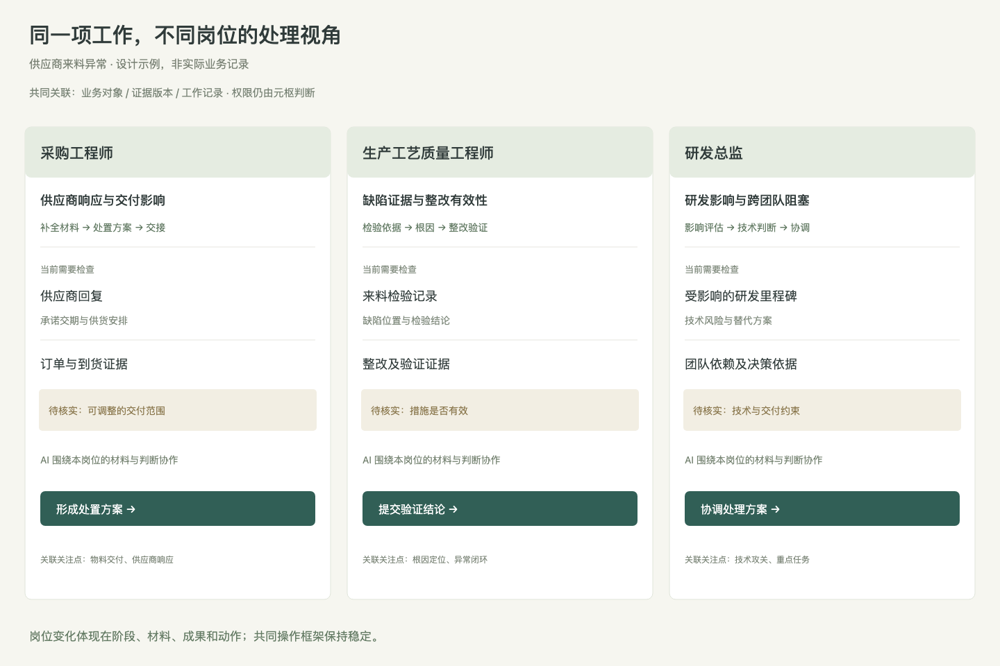
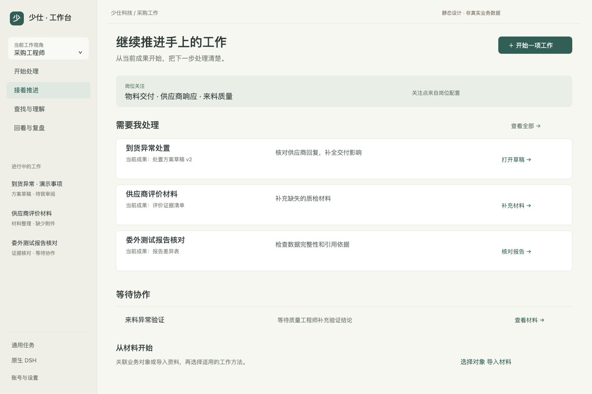
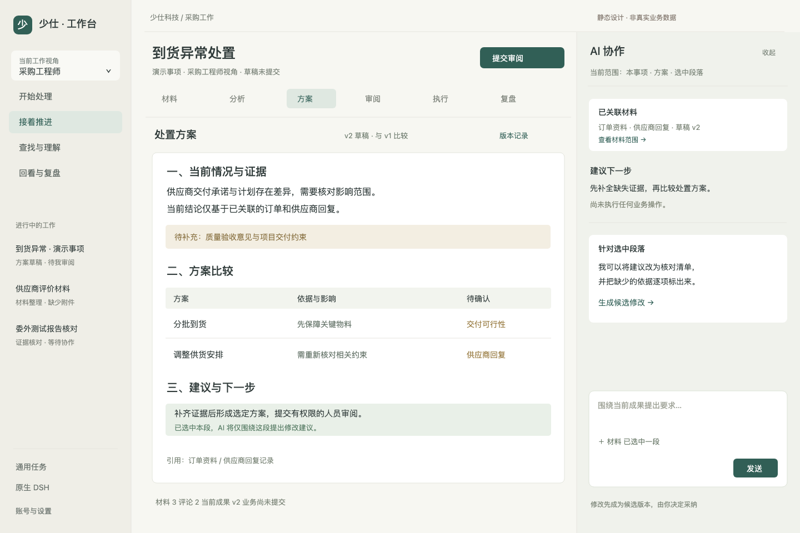
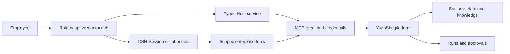

# 少仕科技 DSH 工作台：开发设计文档

[English](design.md) | 中文

## 摘要

员工登录后首先进入岗位专属的私人助理。助理把经授权的元枢变化、待办和临近事项带给员工，说明数据来源、关注原因与建议行动；员工通过 DSH 完成日常工作、协作和 AI 辅助成果，再按授权使用元枢业务能力。界面按岗位调整关注重点，同时保留统一工作流程。本文说明产品范围、参考视频映射、岗位适配、MCP 集成、代码复用与验收方案；原型数据不代表真实业务连接。

## 目录

- [1. 产品定义与交付范围](#product)
- [2. 参考视频与现有实现](#evidence)
- [3. 岗位适配机制](#roles)
- [4. 信息架构与导航](#navigation)
- [5. 首页与工作详情](#screens)
- [6. 代表性业务流程](#journeys)
- [7. 视觉、响应式与交互状态](#visual)
- [8. 领域模型与状态归属](#domain)
- [9. 插件与客户端架构](#architecture)
- [10. MCP 能力与平台协作](#mcp)
- [11. AI 工作方法与上下文](#ai)
- [12. 执行、审批与异常恢复](#execution)
- [13. 身份、数据与权限](#identity)
- [14. 分支策略与复用清单](#reuse)
- [15. 分阶段开发与验收](#delivery)
- [16. 测试、质量与运行观测](#quality)
- [延伸阅读](#references)
- [开发备注](#dev-note)

## 1. 产品定义与交付范围

DSH 在本项目中的定义是“少仕科技员工使用的专用客户端软件”。元枢提供企业身份、业务对象、知识、本体、专业能力、流程执行与审批；DSH 提供面向员工的工作空间、AI 协作和成果处理，通过 Host 侧 MCP 连接元枢。首版面向桌面办公，同时保留 Web 使用路径；是否发布独立品牌安装包是部署事项，需要另行验证打包、签名和升级流程。

| 项目 | 设计要求 | 首版边界
|---|---|---
| 产品入口 | 登录身份、租户、岗位与私人助理一致衔接 | 默认进入助理收件页，保留岗位图表和 DSH 通用任务入口
| 岗位适配 | 入口、材料、步骤、成果、动作随岗位变化 | 选择两种差异显著的岗位验证，具体岗位由业务方确定
| 工作闭环 | 从材料进入，形成草稿，审阅，授权执行，取回结果 | 至少一条真实业务流程完整运行
| 业务来源 | 数据及动作来自元枢发布的能力 | 缺失能力明确显示，演示数据只用于标明的原型
| 专用插件 | 业务能力独立组合，可安装、禁用、升级 | 不在 agent loop 中加入少仕业务分支

首版不覆盖全部岗位和全部业务，也不开发通用低代码页面编辑器。岗位工作包先采用经审阅的声明式配置和少量内置成果渲染器；客户端只展示其支持且获授权的能力。业务成功以元枢返回的结果为依据，AI 的文字回答不能代替审批或业务提交成功。

登录后由 Host 确认当前用户、租户、有效岗位和授权范围，再从允许的 MCP 能力读取与本人相关的变化、任务、协作请求和时限。助理按影响、时限、责任人和工作阶段排序，并为每项显示来源、原因与下一步；没有数据或授权时明确显示缺失状态，不生成虚构预警。DSH 提供会话、模型协作、文件与任务体验；元枢 MCP 提供有权限的业务查询和操作。会改变业务状态的操作须展示对象、版本和影响，并遵守平台确认、审批及结果核验规则。

## 2. 参考视频与现有实现

参考资料为[《DeepSeek Harness 还能这样用？我把它改成了专属 AI 工作台》](https://www.bilibili.com/video/BV11XWa68ESR/)。本次读取覆盖 16 分 20 秒视频的逐秒画面字幕 OCR，并检查周期性完整画面文字；没有将音频转写作为依据。时间点用于定位，字幕识别可能有误差。采用的是视频的工作组织和迭代方法，少仕业务名称、审批制度和实际流程仍需由业务方提供。

| 画面或方法位置 | 视频中的组织方式 | 少仕 DSH 的设计映射
|---|---|---
| 约 01:20–01:40 | 按开始处理、接着推进、查找理解、回看复盘组织入口 | 左侧保留工作意图；首页先汇集岗位相关变化和需要继续的工作
| 约 02:40–03:20 | 多条节目主线、阶段页签、实际内容居中 | 工作事项可持续恢复，阶段和成果占据中心区域
| 约 03:20 附近 | 针对具体片段和时间点提出审阅意见 | 评论绑定成果版本及具体字段、段落或时间位置
| 约 10:40–11:00 | 用熟悉的真实任务试交互原型 | 先用真实材料验收工作路径，再扩充岗位和功能
| 全片的方法主线 | 整理经验为 Skill、规划全流程、原型、开发、连接能力、对照成熟成果迭代 | 以岗位方法、样例成果和业务验收标准驱动开发

在 `feature/yuanshu-platform` 中，已检查 `ui-yuanshu-chat`、`yuanshu-client`、`yuanshu-gateway`、`yuanshu-tool` 及相关测试；检查覆盖该分支的岗位工作台和 MCP 修改。`RoleWorkbench.tsx` 已按平台返回岗位展示不同标题、指标、待处理项和记录，属于有价值的岗位数据基础。现有页面组织主要是简报、指标与列表；本提案进一步把工作事项、分阶段成果和上下文协作作为主路径。此判断来自源码检查，没有把现有页面的实际渲染或业务可用性视为已验收。

## 3. 岗位适配机制

岗位适配贯穿一项工作的处理过程。平台发布岗位工作包，声明员工关心的业务对象、优先事项、可用工作配方、成果视图和授权动作；客户端用稳定组件呈现这些声明。切换岗位必须带来可验证的内容和操作变化，不能只改欢迎语或指标名称。

| 适配维度 | 平台提供 | 客户端行为
|---|---|---
| 工作入口 | 工作包版本、已授权岗位、可见工作与排序依据 | 显示当前岗位，突出需要本人行动的工作，可查看排序原因
| 流程 | 配方版本、阶段、前置条件、完成依据、参与人 | 按实际工作显示阶段，只启用满足前置条件的动作
| 内容 | 对象、字段可见性、证据、支持的渲染器 | 显示岗位相关列、证据及成果编辑器
| AI 协作 | 方法引用、输入输出要求、工具范围、审阅标准 | 以当前工作和选中材料启动协作，形成可审阅结果
| 下一步 | 责任人、允许操作、权限与审批要求 | 显示具体业务动词、执行范围、待谁处理

每个岗位的典型场景由已确认的 KPI、业务对象和日常任务构成。平台提供 KPI 口径、当前状态、来源证据、更新时间、触发原因及关联工作；客户端将场景交给该岗位的工作方法处理。助理先检查材料完整性，列出事实和缺口，提出下一步并准备成果草稿；员工负责复核并决定是否采纳或发起授权业务操作。业务负责人需要审阅 KPI 与场景的关联，客户端不得依据岗位名称或演示数值推断正式预警。

以同一个“来料异常”设计案例说明差异：采购看到承诺交期、供应商回应和处置草稿；质量岗位看到检验结果、缺陷证据和整改验证；研发总监看到对研发交付的影响、方案差异和待协调事项。页面中的工作编号和业务对象保持关联，但各岗位的字段、阶段和主要动作不同。以下仅为验证适配机制的示例，不代表少仕现行制度。

| 示例岗位 | 首页优先关注 | 中心成果 | 主要动作
|---|---|---|---
| 采购 | 哪些承诺影响当前交付 | 到货异常处置草稿与证据 | 补充回复、比较方案、提交审阅
| 生产工艺质量工程师 | 哪些异常缺少根因或验证 | 根因分析与整改证据 | 核对检验、提出整改、提交验证
| 研发总监 | 哪些事项阻塞研发交付 | 影响分析与方案对比 | 请求补充、协调资源、处理授权范围内的决策
| 项目管理 | 哪些事项影响里程碑 | 交付影响清单 | 核实依赖、调整建议、跟踪执行结果

多岗位用户显式选择“当前工作视角”，可固定常用岗位；“全部待办”按本人应采取的行动去重聚合。切换视角不改变身份、租户或授权，不重建已有工作、不丢草稿，也不自动重跑 AI。其他岗位可以查看或编辑什么，由元枢逐请求判定；客户端隐藏按钮只负责表达权限。

工作包采用版本化声明，至少关联岗位、工作配方、视图标识、可用动作、方法引用及数据范围。客户端校验版本与渲染器支持情况，不执行平台下发的 JavaScript、任意 HTML 或样式。未知视图显示可定位的“不支持此工作视图”和升级说明；保留安全的只读概要，不伪装成已经完整加载。

### 3.1 少仕岗位与 KPI 的只读核实

2026-11-16 使用用户提供的连接信息，以只读会话核实到：`go_admin_kit` 是数据库，表位于 `public` schema；`postgres` 数据库中没有这两张表。少仕科技对应 `tenant_id = 3`、租户代码 `shaoshi`。本次只查询结构、岗位与 KPI 配置，没有修改数据，也没有把连接地址、密码、员工姓名或 KPI 原文全集保存到仓库。

| 核实项 | 观察结果 | 设计影响
|---|---|---
| 岗位 | 18 个未删除岗位，均为 `status = 1` | 工作包必须覆盖研发、生产、质量、销售、管理等不同工作方式
| 当前 KPI | 200 条未删除且 `is_current = true`，均为 `review_status = unreviewed` | 可以作为关注点候选；启用考核与自动判定前需业务审阅
| 数据方式 | `auto` 45 条、`semi` 101 条、`manual` 54 条 | 区分已接通计算、待补证据及人工确认，不强制全自动
| 计算与基线 | 200 条 `calculation_formula` 为空；33 条方向为 `unknown`；3 条基线为 `baseline_pending` | 不从目标描述猜测公式、分母、改善方向或基准；实际统计能力仍需通过 MCP 核实
| 持有人分组 | 生产工艺质量工程师、采购工程师、硬件工程师各有两组，每组 10 条 | 同岗位可能有不同职责组合，岗位名不足以决定个人界面
| 标识 | 200 个 `kpi_uid` 唯一；按岗位和 `kpi_code` 有重复，加入持有人分组后无重复 | 复用平台稳定 KPI 标识，不以岗位加 KPI code 去重丢失职责
| 无 KPI 岗位 | 项目管理存在，但没有关联 KPI | 显示业务任务与岗位说明；标记 KPI 未配置，不显示零分或空白死路

### 3.2 从全部实际岗位推导工作视图

下表左两列来自岗位与 KPI 配置；后两列是设计推导，需要用真实业务任务验证。KPI 用于发现员工要做好什么，并关联证据和行动；首页不铺开 200 个指标，也不将配置目标显示为已经达成的数值。

| 实际岗位 | 已配置关注点摘要 | 建议中心工作内容 | 建议首要动作
|---|---|---|---
| 测试工程师 | 调试问题、测试归档、测试保障 | 测试任务、原始记录、问题证据与报告 | 整理记录、登记问题、交付报告
| 生产工艺质量工程师 | 制程检验、根因定位、供应商整改 | 异常分析、工序证据、整改与验证 | 分析根因、发起整改、验证闭环
| 采购工程师 | 物料交付、供应商响应、来料质量 | 订单交付、供应商证据、异常处置方案 | 跟进承诺、补充材料、提交方案
| 小试线经理 | 新产品导入、生产计划、异常响应 | 导入阶段、试生产问题与排程影响 | 处理阻塞、协调资源、确认阶段
| 电机工程师 | 选型、控制算法、联调与文档 | 设计方案、性能对比、验证记录 | 比较方案、分析问题、更新文档
| 市场经理 | 情报、品牌资料、渠道与线索转化 | 市场材料、活动成果、线索证据 | 整理情报、生成资料、推进线索
| 销售经理 | 客户项目、合同履约、回款与复盘 | 客户工作主线、沟通纪要、履约依据 | 更新机会、核对承诺、跟进事项
| 部门经理 | 团队目标、重点客户、经营与融资事项 | 重点工作汇总、决策材料与问题闭环 | 审阅进展、协调资源、作出决策
| 制动系统工程师 | 设计交付、试制问题、图纸与技术维护 | 图纸版本、设计说明、测试与变更依据 | 审查设计、处理问题、发布文档
| 硬件工程师 | 设计、国产化、复用、可靠性与降本 | BOM、方案差异、可靠性问题和验证 | 比较选型、分析整改、提交评审
| 人资经理 | 招聘质量、培训效果、协同与流程效率 | 招聘及培训材料、流程对比、确认记录 | 核对证据、整理评价、提出优化
| 底软开发工程师 | 开发交付、接口、诊断、问题和文档 | 需求、接口说明、问题证据与交付资料 | 分析问题、核对需求、维护文档
| 研发总监 | 研发目标、攻关、流程、建模与实验数据 | 研发里程碑、技术风险、攻关与评审成果 | 审阅技术决策、处理跨团队阻塞
| 生产技工兼库管 | 装配、检验、仓库账实、发料与异常 | 当前工单、操作记录、出入库及异常 | 按步骤登记、核对物料、上报异常
| 设备工程师 | 完好率、维修、预防维护、安全隐患 | 设备履历、故障记录、维护计划和证据 | 登记故障、执行维护、验证恢复
| 质量工程师 | 不合格品评审、质量控制、改进与归档 | 不合格项、评审依据、措施和验证结果 | 审查证据、评审处置、验证闭环
| 特种车业务总裁 | 研发目标、技术问题、产品里程碑与经营 | 产品与经营影响、跨部门依赖、备选方案 | 判断影响、配置资源、决策跟踪
| 项目管理 | 暂无 KPI 配置 | 项目计划、里程碑、依赖与责任事项 | 维护计划、协调阻塞、跟踪交付

建议优先用“采购工程师 + 生产工艺质量工程师”验证供应商来料异常，再用研发总监视角检查影响与协调。这个组合有实际岗位及相关 KPI 作为依据，能够验证同一对象的岗位差异；具体流程、审阅人与业务可写操作仍需业务方和平台确认。此组合只是实施优先级建议，其余岗位按工作包逐步扩展；本次未观察到的岗位不能作为已配置岗位处理。

### 3.3 从岗位配置到可执行工作包

元枢发布层组合 `sys_positions` 的岗位标识与说明、`sys_position_kpis` 的关注点和证据要求，以及 `sys_user_positions` 中的用户任职、主岗位、有效期和状态。`sys_position_default_roles` 可提供岗位与权限角色的关联，但不替代用户实际授权。这两张关联表本次仅核实字段结构，未读取员工任职记录或验证权限语义。岗位、任职和权限角色是三个概念，不以字符串相等推断授权。

持有人分组必须由平台给出到当前用户或职责组合的明确关联；不能让客户端用员工姓名模糊匹配 `holder`，也不能任意选第一组。工作包保留稳定 KPI 引用、分组、版本、生效范围与审阅状态。缺少关联时显示岗位级共同关注点，并标记个人 KPI 尚未确定，不自动合并为考核分数。

从 KPI 到工作入口采用业务审阅的映射：关注点 → 业务对象与证据 → 可执行配方 → 当前事项 → 成果与复核。只有数据源已接通、计算口径已确认且具备权限的 KPI 才显示当前值、差距与预警；其余显示“需补充数据”“待人工确认”或“口径待确认”。`data_sources` 的文字说明不是数据连接配置，`auto` 标记也不保证实际已自动计算。

数据库核实仅用于此次设计；正式客户端不直连 PostgreSQL，不持有数据库管理员凭据。平台提供经授权的岗位、关注点、指标证据和工作包 MCP 投影，Host 按当前用户租户访问。需要修正配置或确认 KPI 时进入平台已有管理流程，不在 DSH 中静默改写原始岗位表。

## 4. 信息架构与导航

采用“助理收件 + 岗位图表 + 持续工作 + 成果与 AI 协作”的结构。登录后默认显示助理收件；图表用于追查指标和比较趋势，工作详情承载材料、成果、审阅与执行。岗位决定数据排序和主要行动，操作位置保持稳定，便于跨岗位协作。

| 区域 | 内容 | 交互规则
|---|---|---
| 左侧顶部 | 少仕品牌、当前岗位、我的助理、岗位工作台和开始工作 | 岗位可切换；助理始终保留在固定入口
| 左侧下方 | 进行中的工作、收藏、最近打开 | 显示标题、阶段、待本人或他人处理；支持搜索和归档
| 中心顶部 | 工作标题、状态、责任人、阶段、与本事项有关的操作 | 显示真实状态和更新时间，危险操作使用明确文案
| 中心主体 | 助理关注项，或工作详情中的材料、成果、审阅和业务结果 | 每条关注项显示来源、原因、责任与可执行的下一步
| 右侧 | 当前工作的 DSH 协作、建议下一步、选中内容、执行状态 | 可收起；上下文范围可见，执行状态关联原 Run
| 全局入口 | 通用任务、原生 DSH、账号与设置 | 返回专用工作时恢复同一事项、草稿和 Session

“查找与理解”用于检索知识或业务对象，结果可以附到已有工作，也可以以明确的工作配方开始新事项。“回看与复盘”以完成成果、采纳情况和可复用方法为主；统计图只在具体岗位确实需要比较时出现。开发者工具、MCP 工具目录和连接诊断放在获授权的诊断入口。

助理页是数据主动抵达员工的工作入口，不是全租户仪表盘。它读取当前用户可见的事件和工作变化，将依据、更新时间、关联对象、下一责任人和建议行动一起呈现；员工可直接打开事项、确认材料或进入岗位图表。重复通知需要归并，已过期或已处理的关注项需要降级或关闭；每项操作仍服从元枢授权。

## 5. 首页与工作详情

以下为静态设计草图，用于评审空间分配和工作主路径；它们不是已运行的插件截图。图中姓名、编号、材料和业务内容均为设计示例。实施时沿用 DSH 主题、组件和本地化系统，不把草图的像素值直接作为新增全局常量。

岗位工作台用于查看指标、趋势和岗位工作方法；它是助理收件后的分析入口，不再承担默认首页。助理首页先呈现按岗位筛选的重点提醒、待本人处理事项和临近日程。每项提醒可追溯到经授权的数据来源，解释为何出现，并直接进入相关工作；空状态说明当前没有可确认的新事项，不填入合成告警。

助理首页还按当前岗位展示 KPI 典型场景和日常工作。每项 KPI 场景关联典型工作、方法、来源材料与交付物，助理先按方法整理依据并生成待复核草稿；日常工作列表则让员工用助理继续推进岗位的例行任务。岗位图表、KPI 数值与场景关联在原型中都是演示配置，不能视为已核定的指标口径或真实预警。

工作详情的中心必须能直接查看、编辑和比较成果。示例中的“材料 → 分析 → 方案 → 审阅 → 执行 → 复盘”由具体配方定义；并非所有岗位固定经历六个阶段。当前阶段显示完成条件、缺少的材料和责任人，阶段完成由保存的成果或平台状态判断。

右侧 AI 输入框明确“基于哪些材料、当前选中什么”。用户可选择段落、表格行或附件，要求解释、改写或补全；AI 的修改先成为可比较的候选版本，员工选择采纳、部分采纳或退回。提交到业务系统的按钮独立显示动作、对象和影响，不把普通聊天发送等同于业务批准。

评论绑定成果版本及字段、段落、页码或媒体时间。若成果发生变化，旧评论保留原位置和版本，显示需要重新核对；无法准确重定位时，不把评论附到猜测的位置。多人修改使用版本条件，冲突时保留本地草稿并展示差异。

## 6. 代表性业务流程

以下案例用于检验设计是否覆盖跨岗位、材料处理和授权执行，不构成少仕业务需求确认。开发第一阶段应以业务方认可的真实材料替换，并定义一份“合格成果”作为对照。

### 6.1 来料异常：采购发起，相关岗位参与

采购从一条异常订单进入工作，关联检验记录、承诺交期、供应商回复和交付约束；AI 检查缺项并形成有引用的处置草稿。员工比较方案，保存选定版本，发给平台确定的审阅人；质量岗位检查缺陷和整改证据，研发管理岗位评估研发影响及协调需求。审批通过后仅执行原批准版本对应的动作，并回取业务结果。

验收重点：采购和质量岗位看到不同材料、字段及主要动作；切换岗位不泄漏字段；证据不足时草稿显式标记缺项；批准后草稿改变会使原批准失效或要求重新审批，具体规则由平台实施；刷新继续原执行任务，不再次创建处置操作。

### 6.2 质量整改：以根因和验证为主

生产工艺质量工程师从一项质量异常进入，中心展示检验记录、缺陷描述、根因分析、供应商整改与验证证据。AI 区分已知事实、分析假设和待验证项，不凭推测认定根因。工程师提交整改意见，安排或记录验证；只有平台确认完成条件与授权后，才能闭环。根因定位及时性和来料异常闭环等 KPI 关联到相应证据，实际绩效计算仍以已确认口径为准。

### 6.3 知识问答：结论可以转成工作材料

员工从“查找与理解”选择知识范围，以产品或业务对象提问，得到带来源的回答；来源不可用或互相冲突时明确展示。员工可将回答及来源快照附到工作，或用选定配方继续处理。没有正式业务事项的纯问答可使用独立 Session，不强行创建一套审批流程。

## 7. 视觉、响应式与交互状态

视觉方向采用视频中的安静工作空间：暖中性色背景、清晰文本、少量语义强调、较大的成果区域。岗位变化通过内容层级与操作表达，品牌、导航位置和组件语法保持一致。图中的浅色方案用于讨论方向，正式交付同时验证浅色和深色主题。

| 项目 | 设计约束
|---|---
| 空间 | 桌面参考比例约为左侧 220、中心弹性、右侧 320–380；中心成果优先，所有尺寸最终使用共享尺度
| 字体与层级 | 使用系统字体与现有 typography tokens；新增样式字重不超过 500，正文和表格保持可读
| 色彩与形状 | 使用主题语义色、共享圆角和材质；强调选中、风险、缺项与成功，不用颜色单独传达状态
| 密度 | 表格承载可比较数据，文稿承载推理和说明；避免为每个字段建立独立卡片
| 宽度变化 | 三栏空间不足时先收起 AI 为抽屉，再折叠导航；小屏采用工作、材料、AI 单区切换
| 内容溢出 | 标题可换行；表格局部滚动或切换详情；主要动作和当前焦点始终可达
| 可访问性 | 全键盘操作、清晰焦点、带名称图标、读屏状态、对比度与减少动画支持

设计评审需覆盖加载、空数据、无权限、鉴权过期、平台不可达、未知工作包版本、等待审批、执行失败、提交结果未知、草稿冲突和归档只读。区域失败保留已加载内容及输入；界面给出局部恢复动作。待执行、已批准、已提交和已完成使用不同状态文案，不能用一个“处理中”覆盖全部语义。

## 8. 领域模型与状态归属

设计区分业务工作、AI 会话和平台执行，避免刷新、切换岗位或重试时产生重复业务。此处定义提案术语，不改变现有 Session 格式。

| 概念 | 含义与关系 | 权威归属
|---|---|---
| 岗位工作包 | 当前岗位的工作入口、配方、方法与视图；有版本 | 元枢发布，客户端校验支持情况
| 工作配方 | 一类工作的方法、阶段、输入输出及审阅要求；进行中的工作固定版本 | 元枢发布，业务负责人审阅
| 工作事项 | 有业务目标、关联对象、责任人、成果和阶段的持续工作 | 元枢业务记录；聚合读写能力需对接确认
| Session | 围绕工作的 AI 协作记录；一个工作可有多个有明确用途的会话 | DSH Session 存储；不保存平台授权密钥
| Run / task_ref | 一次平台执行及其原始引用；一个工作可包含多次执行 | 元枢；客户端原样保存引用，不自行合成
| 成果版本 | 可审阅文稿、表格或附件及其来源与版本 | 正式成果归平台或其授权文件存储，本地仅保留明确标注的草稿
| 审阅与审批 | 审阅是内容意见；审批是授权状态转换，绑定对象及版本 | 平台判定审批权限及有效性

平台保存业务真相；DSH 持久化工作与 Session 的关联、原 task_ref、成果引用以及协作记录；客户端存储导航、面板宽度和可恢复的草稿。具体持久化实现以现有 storage 与 Session projection 扩展机制为准；新增持久类型、事件和兼容性承诺必须在实施时完成审查及类型变更确认。

断网时只读已获授权的缓存及本地草稿，显示来源和更新时间；首版不排队自动补交业务写操作。重新连接后先核对身份、权限、对象版本和原执行状态，再允许继续；过期缓存不进入新模型请求。配方升级不暗中重排进行中的阶段，需要显式迁移并说明影响。

## 9. 插件与客户端架构

当前界面原型位于 [`client-yuanshu-workbench`](../../../packages/experimental/client-yuanshu-workbench/README.zh.md)，通过标准组合包清单、浏览器入口和 DSH 插槽加载。插件加载后直接打开全屏工作台，仅显示工作台导航，底部按钮恢复 DSH 原始界面。全部 18 个已核实岗位及额外的公司管理层视角均提供对应图表、任务、材料与方法。公司总览可从经营、交付、质量、供应及组织风险进入责任岗位；任务、版本、日历、团队、消息与资料为公共入口；返回按钮使用 DSH 布局服务恢复原会话。原型不连接平台，全部业务记录仅在浏览器内存中模拟。

推荐把产品组合、客户端体验和 Host 业务服务分开维护，复用已有 MCP 与身份基础。下列包名是设计建议，尚未创建；不为每个岗位建立一个包，也不复制整套 DSH 会话界面。

| 建议模块 | 职责 | 限制
|---|---|---
| `packages/client/ui-shaoshi-workbench` | 导航、岗位视图、工作阶段、成果渲染、审阅、上下文协作编排 | 组件不直接连接远程 MCP；不导入其他插件的私有 React 组件
| `packages/yuanshu/yuanshu-workbench` | 工作事项服务定义、MCP 提供者、任务恢复、类型化远程访问 | 集中隐藏协议和执行复杂度；不成为所有元枢接口的透传集合
| `packages/bundle/shaoshi-workbench` | 专用 profile 的插件、品牌与默认布局组合 | 不污染通用 Web 默认配置；只使用受支持的 dsh 启动路径
| 复用的元枢基础 | MCP 连接、OAuth、凭据、发现、资源与专业能力 | 从 feature 按清单移入并验证依赖，不整分支合并

业务组件通过框架 hooks、`useResource` 和 store actions 获取状态，订阅与请求归 store、resource 或 service 管理。身份、租户、岗位或工作版本变化会取消旧请求，并以 generation 标识拒绝迟到响应；读取缓存键包含完整作用域。配置、网络响应、持久化与模型输入处进行运行时校验，同进程已类型化调用依赖 TypeScript。

### 9.1 三栏布局的技术前置验证

master 的 `main` 全局面板不会自动获得 Session；现有右栏在打开非会话全局面板时隐藏。因此，“主区放工作、右侧直接放聊天”不能只靠注册一个新 `main` 就实现。`ui-conversation` 提供 `conversation.content` factory，`conversation.view` 和右栏页签具有 Session 作用域，需要验证组合方式。

P0 技术验证分开处理首页与工作详情：首页使用全局入口；工作详情优先验证 Session 绑定的工作视图与现有右栏页签，并通过公开 factory 复用协作界面。验证必须证明只有一个有效的输入所有者、不会递归挂载工作视图、草稿和附件随同一 Session 恢复。如果现有公开扩展点不足，先提交通用的会话呈现扩展设计，再接业务插件；不得绕过作用域、复制聊天组件或新增独立右侧栏。

所有注册、监听与贡献通过 `ctx.effect()` 或 `ctx.on()` 管理。禁用插件、切换租户或释放 Session 时，先停止消费者及异步任务，再释放连接和凭据引用；卸载后不保留孤立的轮询、工具选择或事件监听。服务定义、MCP 服务提供者与 UI/Agent 消费者组成完整能力，只有独立演进时才拆成更多包。

## 10. MCP 能力与平台协作

现有源码具备多类元枢能力的调用与投影，但源码中的工具名不等于实际租户已经发布。运行时先完成鉴权和发现，再根据 schema、版本、授权范围及支持的操作形成可用功能。以下区分已有调用基础与仍需协商的平台聚合能力。

| 已检查的基础 | 代表性工具 | 本设计用途与验证要求
|---|---|---
| 工作台与岗位 | `workbench_describe`、`workbench_profile`、`workbench_position`、`workbench_home`、`workbench_records` | 复用岗位与可见能力信息；核对真实响应，不将现有列表接口当完整工作事项服务
| 知识 | `knowledge_search`、`knowledge_ask` | 搜索、回答、来源附加；确认集合权限及引用可回溯性
| 本体 | `ontology_spaces`、`ontology_context`、`ontology_objects_query`、`ontology_evidence` | 先选空间和上下文，再查询对象与证据
| 专业与流程 | `scenarios_list`、`agent_delegate`、`scenario_run`，以及发现的算法和 DAG 能力 | 按发布 schema 执行；区分专业 Agent 目录与流程，不凭名称猜测语义
| 执行恢复 | `task_get`、`task_result`、`task_events`、`task_cancel`、`task_resume` | 使用原 task_ref，只提供 `available_operations` 允许的操作
| 审批 | `task_approvals`、`task_approve` | 展示审批人与对象版本；确认平台职责分离与输入补充语义

| 待协商的业务能力 | 最小信息与行为 | 缺失时的产品行为
|---|---|---
| 岗位工作包与配方 | 稳定标识、版本、可用岗位、阶段、方法引用、支持视图与动作 | 显示配置问题，不用前端硬编码岗位规则替代
| 工作事项聚合 | 列表、详情、责任人、关联对象、阶段与条件更新、权限 | 可查看已有业务对象；不伪造可持久恢复的完整工作事项
| 成果与审阅 | 版本保存、条件更新、评论锚点、权限、文件访问与发布 | 保留明确标记的本地草稿，禁用无法兑现的提交或协作
| 跨岗位交接 | 参与人、待谁处理、审阅与批准关系、版本失效规则 | 不把分享链接等同于交接完成或批准
| 业务写入 | 授权操作、幂等标识、输入版本、审批引用、可查询的提交记录 | 隐藏或禁用操作，解释缺少平台能力

以上聚合能力不预设工具名，也不宣称已实现。平台和客户端联合确认返回字段、分页、能力版本、条件更新、错误类别、幂等与恢复方式，并保存真实脱敏响应作为契约样例。网关可以整理已有响应，不能自行创造平台未提供的授权、事务或业务成功保证。

## 11. AI 工作方法与上下文

每条工作配方包含可以实际检验的方法：适用条件、所需材料、关键判断、步骤、成果要求、引用规则、审阅标准、禁止推测的内容和合格样例。业务负责人确认方法，平台发布版本；DSH 在执行时加载与当前工作有关的部分，不把企业资料和全部 MCP 工具一次性放进提示词。

模型上下文按“租户与用户授权 → 当前工作及配方 → 当前阶段 → 选中材料 → 本次需要的工具”逐步展开。知识内容、附件和工具返回是资料，不是提升权限或修改系统规则的指令。可进入模型请求的角色信息、材料选择、引用和工具结果必须可从 Session 日志重建；授权密钥不进入日志。

员工可以看到 AI 使用的材料和准备执行的动作。AI 先产出草稿或建议；涉及外部发送、修改业务、提交审批等动作由明确的业务操作承接。模型 API 连接与元枢业务能力连接分别显示状态，一个可用不代表另一个可用。复盘用于改进方法版本；评论或偶发对话不会自动升级为全公司共享的规则。

## 12. 执行、审批与异常恢复

客户端把“准备请求、平台已接收、执行中、等待输入或审批、终态”分开显示。任务引用是恢复入口；网络错误和 AI 回答都不能据此认定业务操作未发生。

1. 用户选择明确动作，Host 校验身份、权限、对象及成果版本，展示会影响的对象与审批要求。
2. 提交时使用平台认可的幂等标识；拿到 task_ref 后立即持久化关联，后续只查询和操作该引用。
3. 若提交超时且尚未拿到引用，进入“提交结果待核实”，使用平台查询能力或原幂等标识查证；在查明前阻止重复提交。
4. 收到等待审批或 `input_required` 时，保留原 Run 并展示所需输入、授权人及允许操作，不启动替代 Run。
5. 刷新或重连先读取原任务状态；事件续读能力不可用时，查询当前状态及结果，不假设事件恰好投递一次。
6. 只有平台确认取消才显示已取消；只有结果和业务回写证据齐全才显示相应完成状态。

读取重试可以在配置的上限内进行；业务拒绝、权限拒绝、输入不合法和结果未知不能自动重试执行。错误使用结构化类别及本地化恢复建议，保留已完成成果；用户可定位原任务和诊断标识。平台无法核实时，明确由业务或平台负责人核对，不呈现一个会重新执行的普通“重试”按钮。

## 13. 身份、数据与权限

租户、用户、岗位和工作范围共同决定可见数据；权限由元枢判断，Host 强制执行作用域，UI 表达可用性。切换租户不是切换筛选条件，必须撤销旧上下文并重新获取工作包及授权。

MCP 授权复用已有 OAuth 发现、PKCE、issuer/resource 校验、用户租户作用域凭据及撤销机制，并补充专用客户端的会话验证。密钥留在 Host credentials；浏览器不直接访问远程 MCP，不把密钥写入 Session、业务附件或诊断日志。现有登录中的 localStorage token 承载需要专项评估和替换方案，不整段复制作为新的安全基线。

缓存按租户、用户、授权作用域、岗位、工作及版本隔离；授权失效后停止读取及模型上下文注入，注销清理受保护缓存。文件按元枢授权获取并受控导出；敏感字段脱敏、保存期限、允许模型服务及跨设备草稿策略由少仕与平台联合配置，不在前端代码中写死。

## 14. 分支策略与复用清单

已从 `master` 创建独立工作目录中的 `dev` 分支；本次没有修改原 `feature/yuanshu-platform` 工作目录。本次只产出设计与草图，没有迁入功能代码。后续按下表选择文件、依赖和测试，不整体合并 feature 的历史，因为其中包含其他 UI、SDK、测试及 vendor 变更。

下表路径指原 feature 工作目录中的候选来源，在 dev 中不保证已经存在。2026-11-16 最终核实时，来源分支已提交岗位工作台和 MCP 加固修改，工作目录干净；实际迁入前仍需固定来源清单并在 dev 上重新验证。

| 来源 | 选择 | 处理要求
|---|---|---
| `packages/yuanshu/yuanshu-client/src/mcp.ts` | 重点复用 | 迁入 MCP/OAuth/发现/资源/调用基础，审查目录并发修改、依赖及错误语义
| `packages/yuanshu/yuanshu-client/src/index.ts` | 选择复用 | 保留使用到的业务投影与类型，确认 MCP 名称及字段，避免把 legacy HTTP 路径带成隐式回退
| `packages/yuanshu/yuanshu-gateway` | 复用并审查 | 同源代理、授权及凭据作用域；核对所有路由的身份处理与停用释放
| `packages/yuanshu/yuanshu-tool/src/enterprise.ts` | 复用方法与实现 | Session 作用域授权、渐进工具发现、资源访问及生命周期；核对新工作关联
| `ui-yuanshu-chat/src/client/enterprise-resource.ts` | 提取有用机制 | 身份作用域、取消、资源读取、结构化错误；按新服务边界整理
| `ui-yuanshu-chat/src/client/workbench.ts` 与 `storage.ts` | 选择复用 | 能力解释、任务引用与恢复；审查本地敏感数据和持久化版本
| `RoleWorkbench.tsx` 与岗位测试 | 复用数据理解和测试情景 | 保留岗位差异样例与响应知识，重新实现交互组件
| `WorkbenchPanel.tsx`、`EnterpriseWorkbench.tsx`、旧 CSS | 不迁入新产品界面 | 仅参考能力映射及诊断语义，专用工作界面重新设计
| `yuanshu-login-server`、`apps/yuanshu-login`、`ui-yuanshu-account` | 复用身份逻辑，重做体验 | 重新审查 token 传递、品牌、登录回跳和过期态；不复制生成 dist 或环境文件
| 元枢 unit、角色及 live e2e 测试 | 按能力移入 | 复用行为覆盖和合成情景；真实 API 用例单独配置，不能声称本次运行过

实施顺序为：固定候选来源 → 迁入 MCP 与身份基础及最小依赖 → 通过 Host 服务验证一条真实读取和原 Run 恢复 → 新增工作领域与客户端视图 → 接入业务写入 → 整理 profile、文档与升级说明。每批提交只包含相应源码、依赖和测试，依赖锁文件按选定包重新生成；不复制 `.env`、密钥、用户 DSH home 或无关输出。

## 15. 分阶段开发与验收

每阶段用可检查成果结束，再进入下一阶段；不以完成页面数量代替业务闭环。工期在真实材料、平台接口和布局技术验证完成后估算。

| 阶段 | 交付物 | 通过条件
|---|---|---
| P0 业务与技术验证 | 两个岗位的工作地图、一个真实案例与合格成果、平台能力清单、Session 与三栏组合验证 | 业务方确认适配差异；公开扩展点可保留 Session、草稿、附件，或完成通用扩展方案
| P1 交互原型 | 首页、同一工作两种岗位视图、阶段成果、评论与 AI 协作原型 | 使用真实脱敏材料走通；用户能定位下一步、材料、成果与等待对象
| P2 集成基础 | 选择性迁入 MCP、登录、凭据与资源，专用 profile | 验证租户隔离、失效态、真实读取、知识引用；无隐式 HTTP 回退
| P3 首条工作闭环 | 创建或关联工作、草稿、审阅、审批、执行与结果恢复 | 真平台完成一项工作；刷新与超时不重复执行业务；成果达到业务样例标准
| P4 岗位扩展与试点 | 第二岗位工作包、跨岗交接、受限宽度与主题适配、诊断与操作说明 | 岗位变化覆盖字段、步骤和动作；产品/设计审阅通过，试点问题可回溯

首版完成定义：员工能够在自己的岗位入口找到工作，理解所用材料，得到可审阅成果，完成被授权的处理，并在重开客户端后看到原业务结果；另一岗位看到适合其职责的同一工作视图。任何缺失的平台能力和只读范围都在产品中明确表达。

## 16. 测试、质量与运行观测

测试围绕岗位差异、能力服务、执行安全及可恢复成果组织。下面是实施阶段的验证计划，不是本次已经通过的测试报告。

| 层次 | 必须验证的行为
|---|---
| 单元与契约 | 工作包版本、未知视图、字段权限、阶段前置条件、版本冲突、错误分类、分页和缓存作用域
| 生命周期与并发 | 租户切换迟到响应、并行目录发现、Session 释放、插件停用、重复事件、连接重建
| keyless Session 快照 | 角色与材料进入上下文、渐进工具选择、草稿到审阅、等待审批、原任务恢复及用户可见输出
| 真实 API e2e | 隔离测试账号的登录授权、知识与对象读取、一次受控写入、独立审批人、取消及断线恢复
| 真实组装界面 | 浅深主题、长标题、受限宽度、菜单与焦点、草稿保留、右栏展开、岗位切换和无权限态
| 产品验收 | 使用真实任务对照合格成果，检查事实、证据、缺项、下一步与业务结果

GUI 实现 PR 需提供真实服务器和模型流程录制的 GIF，并完成产品或设计评审。新持久类型、工具与事件同步更新对应文档、快照及必要的 SDK 预期输出；对外可感知的破坏性变化同步写入升级指南。本次文档不触发运行时变更或宣称这些 GUI 检查已完成。

运行观测关联 work item、Session、task_ref 和诊断标识，记录授权失败、未知提交结果、恢复耗时、视图加载失败与成果版本冲突，不记录密钥或完整敏感材料。首页先加载岗位和可行动工作，材料与工具按需加载；不请求全租户所有工作，也不同时启动所有列表轮询。首轮用真实网络和代表性材料建立耗时、数据量及模型成本基线，再由产品与平台负责人确定目标和配置上限。

## 延伸阅读

实施应以当前仓库的能力、扩展点及 UI 规则为依据，以下文档提供相邻约束。

- [架构](../../architecture.zh.md)：插件组合、能力服务与 Session。
- [Web 样式](../../web-styling.zh.md)：主题与共享视觉规则。
- [测试](../../testing.zh.md)：真实 API、快照和输出验收。
- [持久类型变更审阅](../../cookbook/reviewing-persistence-type-changes.zh.md)：新增持久化数据时的确认要求。

## 开发备注

此节记录待确认事项，不是已生效产品约定。本文建议有效期至 2026-12-16；产品与工程负责人届时决定更新、归档或提升为正式设计，正式实现的包级行为归各包 README。

- 已确认：DSH 是专用客户端，元枢通过 MCP 提供功能，界面必须随岗位关注点变化，先交付全面设计。
- 待业务方确认：优先建议采购工程师与生产工艺质量工程师；仍需真实材料、合格成果、责任人与审批规则。第 3 节的岗位配置为只读实查事实，流程和界面映射为设计提案。
- 待平台方确认：工作包、工作事项、成果版本、跨岗审阅、幂等与未知提交结果的查询能力，以及现有工具在实际租户中的可用性。
- 待技术验证：Session 与工作详情三栏组合、登录凭据承载迁移、正式成果存储及跨设备恢复；这些事项影响实施顺序。
- 待产品确认：少仕品牌素材、客户端发布方式、支持系统、资料保留及允许使用的模型服务；不影响先评审工作主路径。
