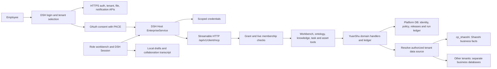
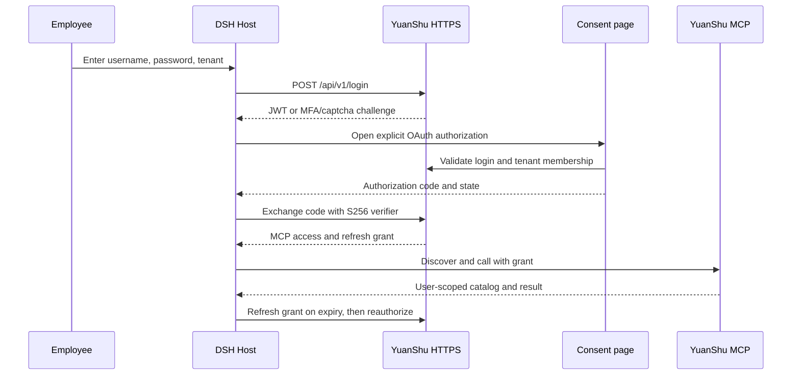

# Shaoshi YuanShu workbench integration design

English | [中文](integration-design.zh.md)

This document is the engineering companion to [the product and interface design](design.md). It records what was verified in the YuanShu source, what was observed in the Shaoshi tenant, what the DSH plugin should own, and what must be confirmed before a live connection. It is a design proposal, not evidence that the integration is deployed.

## 1. Decisions

The first release prioritizes the project manager’s delivery risk workflow. YuanShu provides identity, files, and event delivery over HTTPS. Employee MCP exposes workbench projections, semantic queries, methods, and governed execution. DSH leads position work using its native Session, MCP, and Subagent capabilities as described in section 10.

1. DSH is a dedicated client for an authenticated employee. The default screen is the employee's YuanShu workbench; the general DSH surface remains available through the explicit return entry.
2. The production data path is a Host-owned, user-scoped MCP client to `/api/v1/client/mcp`. The browser does not hold an MCP refresh token and the plugin does not connect directly to PostgreSQL.
3. HTTP remains the right interface for login, tenant selection, file transfer, health checks, and the existing notification transport. MCP is the right interface for governed business context, workbench projections, knowledge, ontology, professional capabilities, and long-running platform work.
4. A Tool is one operation. MCP is the protocol that discovers and invokes Tools and Resources. A DSH-native Tool is an optional task-shaped orchestration over local state and authorized platform calls; it is not a duplicate wrapper for every MCP Tool.
5. YuanShu provides the common entry point for identity, permissions, business reads and execution. The platform database owns common governance and run records; each tenant database owns that tenant’s business facts. DSH owns presentation, local drafts, model collaboration, and recoverable UI state.
6. A role view is selected from effective platform roles and an explicit tenant mapping. A position name, KPI label, or client-side menu must never grant access or infer a user's authority.
7. Every consequential write has an idempotency key, an opaque `task_ref` when asynchronous, an explicit outcome, and a recovery path. A UI confirmation is not an approval, and HTTP 200 is not business success.

## 2. Evidence scope and confidence

The YuanShu source was inspected at `/Users/david/Documents/project/cp_project/cp_project`, including the Go server and Vue client. The checkout was on `main` with three commits ahead of `origin/main` and unrelated uncommitted work. No source files, migrations, environment files, production configuration, or database rows were changed. The source tree therefore describes the inspected implementation, not necessarily the deployed service.

The earlier read-only audit used `go_admin_kit.public` to check platform and position data for the Shaoshi tenant (`shaoshi`). That audit did not validate the Shaoshi business database. This revision treats the separate PostgreSQL database `cp_shaoshi` as the Shaoshi business store, as confirmed by the user and reflected in the platform repository’s ownership analysis and migrations. This revision inspected source and migrations without connecting to a database or verifying the deployed catalog. The earlier source audit ran:

```text
go test ./internal/clientmcp ./internal/tenantaccess
```

Both passed. This does not validate a deployed endpoint, a real OAuth client, a production database, or a live tenant workflow.

Source paths starting with `server/` are relative to `/Users/david/Documents/project/cp_project/cp_project`. Line numbers are review anchors and must be refreshed if the source changes.

## 3. Architecture



The Host service is the only component that owns the MCP connection. UI consumers use a typed Remote/resource service. Model-facing tools receive only the selected, authorized capabilities. The platform reauthorizes both catalog visibility and execution; the client must treat discovery as a hint, never as an authorization cache.

## 4. What YuanShu already provides

### 4.1 HTTP entry points

The public login routes are in `server/internal/api/auth/routes.go` and include `GET /api/v1/login/tenants`, `POST /api/v1/login`, `POST /api/v1/login/2fa/verify`, `POST /api/v1/refresh`, captcha routes, and `POST /api/v1/logout`. Authenticated user routes include `GET /api/v1/auth/me`, `GET /api/v1/user/me`, `GET /api/v1/user/tenants`, `POST /api/v1/user/tenant`, and `GET /api/v1/user/menus`. The console login routes are a separate surface and must not be treated as employee tenant login.

`LoginRequest` in `server/internal/service/auth/user.go:66` accepts `username`, `password`, optional `tenant_code`, and optional captcha fields. The response may contain a user, access token, refresh token, tenant code, or a TOTP challenge. `UserInfoResponse` in `server/internal/api/auth/user_dto.go` contains roles and permissions but does not contain the user's Shaoshi business position or KPI assignment. DSH therefore obtains position and work-pack data after authentication through authorized platform projections.

The existing notification ticket and WebSocket routes are mounted by `server/internal/api/routes_system.go` and `server/internal/api/routes_auth.go`. They can deliver platform notices, but a notification stream is not a durable work-group conversation or an execution event log.

### 4.2 Unified employee MCP

`server/internal/api/client_mcp.go:270` mounts the client service at `POST/GET /api/v1/client/mcp` when the client MCP configuration is enabled. The service uses the official Go MCP SDK Streamable HTTP handler and stateless operation in `server/internal/clientmcp/server.go`. The catalog is assembled from explicit operations, database capabilities, published assets, workbench adapters, ontology, knowledge, and task operations. It is not a direct dump of `mcp_tool_registry`.

The OAuth implementation in `server/internal/clientmcp/oauth.go` uses protocol version `2026-07-28`, exact issuer/resource/client/redirect validation, Authorization Code with S256 PKCE, read or read-plus-execute scopes, five-minute authorization codes, rotating refresh pairs, and live tenant-membership checks. Normal JWTs and service keys are rejected as MCP access tokens. The consent page in `server/internal/clientmcp/consent.go` can submit the platform login, but the current page does not complete the MFA/captcha branch; production DSH must provide a clear platform login continuation for that case.

`/api/v1/mcp/catalog` is a read-only management preview. `/dap/mcp` is a management/test page. Neither is the DSH execution endpoint. Old standalone DAP SSE is a compatibility path and is not the employee integration path.

### 4.3 Workbench and business capabilities

`server/internal/api/client_mcp_workbench.go` provides adapters for `workbench_describe`, `workbench_profile`, `workbench_home`, `workbench_position`, `workbench_positions`, `workbench_briefing`, `workbench_decisions`, `workbench_navigator`, and `workbench_records`. These are the preferred deterministic reads for the workbench UI. They accept bounded position/domain/page/keyword/status inputs and do not expose arbitrary route or database names.

`server/internal/api/client_mcp_operations.go` provides directory and scenario operations, ontology reads, knowledge search and sessions, action preflight/request/approve/execute/get, pinned algorithm/skill/DAG execution, agent delegation, scenario runs, and compatibility aliases. The same file documents legacy aliases and their replacements. A published asset is executable only at its pinned revision and only when the current grant can execute it.

`server/internal/api/client_mcp_tasks.go` normalizes task, execution, workflow, scenario, and action records. `task_ref` is an opaque locator for a platform record. `task_get`, result, events, cancel, resume, approval, and available-operation fields are the recovery surface. An unknown state is non-terminal until reconciled. An approval reference authorizes the platform operation; a user clicking Confirm does not replace the approver.

`server/internal/clientmcp/contracts/business-result.schema.json` is the result authority. It distinguishes `accepted`, `input_required`, `succeeded`, `failed`, `cancelled`, `rejected`, `timed_out`, and `unknown`, preserves the task reference and original data, and requires a stable retry instruction. The DSH UI must display these distinctions.

### 4.4 Database capabilities

`server/internal/api/client_mcp_database.go` exposes only enabled, valid database handlers from the DAP registry. Read queries have bounds such as `limit <= 1000`, `max_rows <= 10000`, and `timeout <= 120s`; actor and tenant keys cannot be supplied by the caller. Normal employees should receive ontology and workbench projections rather than raw SQL and schema tools. A database registry entry is an implementation capability, not permission to hand the model unrestricted business data.

### 4.5 Tenant business databases and employee-visible catalog

The platform database holds identity, membership, positions and policy, data source registrations and credential references, published ontology and mappings, knowledge, and platform run audit. Shaoshi project, procurement, engineering, manufacturing, quality, delivery and finance facts remain in `cp_shaoshi`; the Shaoshi app owns its business tables and migrations. The platform database can hold governed references, projections and evidence revisions without making a second authoritative copy of business facts. See `server/docs/少仕数据库与元枢平台数据职责边界分析-20261109.md` and `server/sql/shaoshi/migrations/202610290001_shaoshi_business_tables.sql`. A migration inventory is not a deployed MCP catalog.

Platform administrators use management APIs to register sources, test connections, scan schemas, approve field classifications, bind ontology and publish catalogs. After grant validation, the server resolves the registered source from the authenticated tenant, isolates pools by tenant and source, and uses least-privilege read-only credentials for reads. Employee calls accept platform-issued logical references; they do not accept database names, connection strings, arbitrary schemas or tenant overrides. A missing, ambiguous or unavailable binding returns an explicit status without falling back to the platform database or another tenant. Domain services handle writes and independently check business ownership, record version and release conditions.

The initial employee MCP uses the same `/api/v1/client/mcp` without deploying one MCP service per tenant. These proposed logical names must be reconciled with the existing DAP Tools and ontology interfaces before publication. Employees can discover approved business tables or views and safe field metadata. Physical topology, full database scans and advanced queries are limited to approved data roles.

| Proposed MCP capability | Input and output | Consumer |
|---|---|---|
| Tool `tenant_data_list_objects` | Domain, type and cursor → opaque `object_ref`, logical table/view name, business meaning, available operations and catalog revision | Workbench data navigation; Agent source discovery as needed |
| Tool `tenant_data_describe_object` / versioned dictionary Resource | `object_ref` and optional revision → authorized fields, types, units, null semantics, enums, allowed filters, business keys, visible relationships and ontology bindings | Charts, tables and SOP evidence; Resource reads recheck authorization |
| Tool `tenant_data_query_records` | `object_ref`, authorized fields, typed filters, ordering and cursor → authorized records, record references, source revision and freshness | Deterministic pages, metric details and Agent evidence; aggregations default to published metrics |
| Published ontology Resource and ontology context/query/evidence Tools | Ontology release, class, relationship or business object reference → authorized concepts, paths, linked records and evidence locators | Agent explains dependencies and impact; DSH displays verifiable business references |

Apply object and field policy before returning catalogs, descriptions or ontology dictionaries. Recheck policy at execution and enforce row scope in filters, joins and aggregations. Counts, foreign keys, column comments and errors must not reveal hidden data. Bound page size, query complexity, runtime and response bytes; ordinary employees cannot submit arbitrary SQL. Return the same response for unauthorized and nonexistent objects. Return distinct errors for unavailable authorized sources or broken mappings, so an outage does not render as no risk. Cursors bind the query, tenant, principal, policy and catalog revision; rediscover when those versions change.

The platform should maintain `ontology release → class/relationship → object and field mapping → record/evidence reference` and register stable logical IDs and data owners. Validate migrations and mappings before switching the published release. Disable affected calls and flag incompatible drift for repair. Scope DSH caches to the authorized principal, tenant and catalog revision; clear usable caches on tenant switch, permissions change and revocation. Session history, forks and evidence rereads follow the permission and retention rules in section 10. Audit principal, logical source, object, mapping revision, operation and outcome summary without storing sensitive row contents in general audit.

For the Shaoshi pilot, use controlled projections of migration tables `prj_projects`, `prj_project_milestones` and `prj_project_risks` and publish semantics for projects containing milestones and risks affecting milestones. Relationships require verified keys or explicit mappings. The project manager opens the workbench from a risk notification. The Host fetches authorized milestone data and evidence, and native Conversation reads ontology and records as needed. Commit risk changes and business events in the business database first; the platform deduplicates by event ID, filters authorized recipients and delivers notifications. Reliable cross-database delivery requires a business outbox or verified CDC; the platform notification does not replace the business commit.

## 5. API, MCP, and Tool allocation

| Capability | Interface | Reason and owner |
|---|---|---|
| Username/password, tenant list, MFA/captcha, refresh, logout | YuanShu HTTPS API | Interactive authentication and token lifecycle; DSH Host owns the handoff, YuanShu validates identity. |
| Current user, menus, tenant membership and connection health | HTTPS API, then MCP identity/workbench reads | Bootstrap contracts are deterministic; business context must be scoped through the grant. |
| OAuth discovery, consent, token, revoke | HTTPS OAuth endpoints | MCP transport authorization; never substitute the platform JWT. |
| Workbench home, profile, position, briefing, decisions, navigator, records | MCP `workbench_*` Tools | Existing governed projection; Host can call deterministically for the UI. |
| Ontology spaces, collections, releases, context, queries and evidence | MCP Tools/Resources | Versioned, governed semantic reads; the model can select bounded operations. |
| Knowledge search, answer, document, collection and sessions | MCP Tools/Resources | Source-grounded AI context with citations and sensitivity checks. |
| Published Skill, Algorithm and DAG execution | MCP Tools | Revision-pinned long-running operations with platform ledger and approvals. |
| Task, execution, workflow, scenario and action recovery | MCP `task_*` Tools | One recovery vocabulary across platform run types. |
| File upload/download and controlled export | HTTPS API or dedicated file service | Large binary transfer and retention are clearer outside a model tool. |
| Platform notices and notification ticket/WebSocket | Existing HTTPS plus WebSocket | Delivery hint only; the source record remains a YuanShu notice or business record. |
| Creating a durable work group, membership, messages and history | New platform capability required | Existing notice and meeting tables do not prove a group-chat API. Do not create a DSH-only shared truth. |
| DSH draft, attachment selection, prompt context and local view state | DSH Session/storage | Local collaboration state; never presented as platform approval or business submission. |
| Multi-read role brief or cited draft | DSH-native Tool over selected MCP calls | Useful orchestration when it reduces real model planning; preserve source IDs and never claim a write. |

The rule is: use an API for control-plane and transport concerns that a client must call predictably; use an MCP Tool for an authorized business capability that should be discoverable, schema-described, versioned, audited, or selected by an assistant; use an MCP Resource for stable read context; use a DSH-native Tool only for DSH-owned orchestration. Both API and MCP entry points must call the same platform handlers and authorization policy.

### 5.1 Recommended YuanShu exposure contract

The following is the concrete first-release split. “MCP Tool” does not mean that a language model must choose the operation: the DSH Host may call the same Tool deterministically for a screen, while the model receives only the subset selected for its current work.

| YuanShu capability family | Expose as HTTP API | Expose as MCP Tool or Resource | DSH usage |
|---|---|---|---|
| Identity bootstrap | `GET /api/v1/login/tenants`, `POST /api/v1/login`, MFA/captcha verification, `POST /api/v1/refresh`, logout, `GET /api/v1/user/me`, `GET /api/v1/user/tenants`, tenant switch | Do not expose password login as a Tool. Expose the resulting scoped identity through `workbench_profile` or a dedicated read projection. | Host performs login and OAuth consent; UI receives a typed identity state. |
| MCP authorization | OAuth discovery, authorize, token, revoke and protected-resource metadata | No duplicate login Tool. | Host owns PKCE, refresh rotation, revoke and grant partitioning. |
| Workbench reads | Health/readiness, static client configuration and large binary transfer | `workbench_describe`, `workbench_profile`, `workbench_home`, `workbench_position`, `workbench_positions`, `workbench_briefing`, `workbench_decisions`, `workbench_navigator`, `workbench_records` | Host calls Tools directly for deterministic panels; the model can use selected projections to explain or prioritize. |
| Semantic business reads | No ad hoc endpoint per role card | Ontology space/collection/release/context/query/evidence Tools; bounded object query; knowledge search/ask/document/collection/session Tools; stable published documents as Resources | Host renders source-backed data; model uses bounded reads with citations. |
| Methods and SOP | Administration CRUD for authors and publishers, if needed | Published Skill/SOP/recipe as versioned Resource; `scenarios_list` or a read Tool for applicability | UI renders nodes and method version; execution remains a platform run. |
| Explicit business writes | Dedicated typed API only when it is an application control-plane operation with a stable form contract, such as a small profile or tenant setting update | Domain writes, proposals, action preflight/request/approve/execute, scenario run, and published Skill/Algorithm/DAG execution as narrowly scoped Tools | User starts the action from a visible stage; Host supplies schema, revision, idempotency key and confirmation. |
| Long-running work | Health and administrative cancellation endpoints only where platform operations already require them | `task_get`, `task_result`, `task_events`, `task_cancel`, `task_resume`, `task_approvals`, `task_approve` | One recovery vocabulary for all run kinds; never create a second DSH task ledger. |
| Files | Upload/download, range transfer, virus scan, retention and export | A Tool may create or locate a file reference, but should not stream arbitrary binary content through model context; file metadata can be a Resource | Host transfers bytes and passes only scoped references to the model. |
| Notifications | Ticket issuance and WebSocket/SSE delivery | A read Tool may list source notices; notification delivery is not a Tool | DSH turns notices into assistant signals linked to the source record. |
| Work groups and calendar | CRUD APIs if YuanShu defines membership, message, meeting and history semantics | Once governed contracts exist, use `workgroup_*` and `calendar_*` Tools for assistant search, agenda preparation and task linking; expose message history as a paginated Resource | Until then show unavailable integration state, not local shared truth. |
| Raw database access | Keep behind internal DAP APIs and policy enforcement | Expose only explicitly enabled, read-only, bounded database Tools for administrators or approved data roles; do not expose schema/query by default to ordinary employees | Prefer workbench and ontology projections. |

The platform should not expose a separate REST endpoint for every role dashboard card, KPI tile, or assistant suggestion. Those are projections of governed workbench and ontology data. It should also not expose raw `mcp_tool_registry` rows as a client catalog: the unified catalog must apply tenant projection, role permission, schema, revision, and execution policy before listing or invoking a capability.

### 5.2 MCP Tool admission rules

An operation belongs in the customer MCP catalog only when it has a stable name, JSON schema, tenant and actor derivation from the grant, explicit read/write annotation, permission check, bounded input/output, structured errors, audit behavior, and a version or revision rule. Writes additionally need idempotency and a queryable task or result reference. If an operation is only a UI transport detail, a credential exchange, a binary stream, or a platform administration concern, keep it as HTTP.

The DSH Host must treat every discovered Tool as untrusted capability metadata until it checks the current grant, input schema, revision, and supported operations. A Tool can be used by the UI without being made visible to the model. Conversely, making a Tool visible to the model does not grant permission or replace a human approval.

### 5.3 Agent-first active work loop

The target experience is “work finds the person”, not a menu that waits for a person to search. The first release should implement this loop:

1. A platform notice, business change feed, scheduled checkpoint, overdue threshold, or newly available task enters the DSH Host. Delivery can use the existing notification ticket/WebSocket path or a new durable event-feed API. MCP catalog subscriptions only describe capability changes; they are not a durable business-event guarantee.
2. The role Agent evaluates relevance using the current user's tenant, effective roles, position mapping, KPI state, ownership, due date, severity, and freshness. It records why the item was selected and deduplicates by source record and event version.
3. The Agent calls bounded `workbench_*`, ontology, knowledge, and task Tools to assemble evidence. It loads the applicable SOP/Skill Resource and creates a structured work brief with facts, gaps, risk, recommended next step, and confidence.
4. The Agent prepares a draft, checklist, agenda, comparison, or escalation. Preparation may be automatic; external communication, business mutation, approval submission, and execution remain behind a visible confirmation or platform approval.
5. The Host persists the source reference, method revision, evidence references, draft version, pending human decision, and any `task_ref`. It shows the employee one actionable inbox item rather than a collection of unexplained alerts.
6. After confirmation, the Agent calls the narrowly scoped MCP write Tool with idempotency and revision. It follows the original task until a verified terminal result and brings failures or new inputs back to the employee.

This makes the API/MCP boundary complementary: HTTP/event delivery wakes the Agent, MCP reads and Tools let it understand and act, and DSH Session state makes the interaction legible to the employee. A periodic DSH scheduler may be used as an interim trigger, but production scale needs a durable platform event source, cursor, replay window, tenant filtering, and deduplication contract.

### 5.4 Capability exposure by YuanShu domain

The runtime catalog should expose capabilities by lifecycle stage. Administration and publishing can remain behind YuanShu's authenticated management APIs; the DSH client receives only published, tenant-scoped runtime capabilities through the MCP catalog.

| Domain | Runtime discovery | Read/context surface | Execution surface | Result and governance |
|---|---|---|---|---|
| Ontology | `ontology_overview`, `ontology_spaces`, `ontology_collections`, `ontology_releases` | `ontology_context` returns the fixed release's object types, fields, relations, rules and supported query operations; `ontology_evidence` returns runtime audit evidence | `ontology_query` for the semantic planner and `ontology_objects_query` for advertised object fields, filters, links and pagination | Require consumer binding, release ID, row policy and permission on every call. Never accept arbitrary SQL or caller-supplied tenant/actor identity. |
| Skill | Catalog entry with published status, interaction mode, exposure and revision | Resource `yuanshu://skills/{id}/{revision}` or read-only `skill_<name>` for frozen `SKILL.md` and relative references | Only a published executable Skill gets a dynamic `skill_<id>_execute` Tool with a fixed revision and idempotency key | Instruction Skills are context, not code execution. The client must not execute container commands or treat a Skill document as a permission grant. |
| Algorithm | Published asset metadata, input/output schema, owner, revision, sensitivity and allowed tenants | Schema and method metadata through catalog/resource; large artifacts remain file references | Dynamic `algorithm_<id>_execute` Tool, requiring the catalog revision and idempotency key | Enforce asset permission, input limits, data scope, approval policy and task ledger. Never let the model select an unpublished or mutable revision. |
| Professional Agent | `scenarios_list` and published agent/scenario bindings expose immutable target revision and supported inputs | Read the binding, method, input requirements and capability description; do not expose hidden prompt or server identity | `agent_delegate` for an explicit subtask, or `scenario_run` for a published scenario; the server chooses the DSH target and returns a child run | The caller supplies correlation only. Platform chooses target identity/policy, checks revision and ownership, and returns a `run_id`/`task_ref`; DSH remains the top-level orchestrator. |
| DAG/workflow | Published workflow directory, `dag_history`, and authorized run metadata | `yuanshu://workflows/{id}` or `yuanshu://runs/{id}` for authorized definitions, inputs, checkpoints and results | Dynamic `dag_<id>_execute` Tool; legacy `dag_run_*` operations remain compatibility aliases while `task_*` is primary | Pin revision, freeze inputs, enforce approvals and checkpoint rules. Resume requires the original checkpoint, pending action, approval and idempotency key. |
| Scenario | `scenarios_list` plus `scenario_bindings_list` for published/deployed scenarios | Binding and method description, required material, expected outcome and allowed operations | `scenario_run`; cancel/events/result use the unified `task_*` layer | A scenario is a published business recipe, not a second Agent wrapper. Do not create a new DSH task when the platform already returned a Run. |
| Action and approval | `approvals_list` and action capability metadata | `action_preflight` explains target, version, impact, required fields and approval route | `action_request`, `action_approve`, `action_execute`, `action_get`; expose `task_approve` only to designated approvers | Separate employee confirmation, delegated execute scope and designated approver permission. Every write is idempotent and auditable. |
| Knowledge | `knowledge_collections`, readiness and authorized session list | `knowledge_search`, `knowledge_ask`, `knowledge_document`, session turns, and document/collection Resources | No generic “write knowledge” Tool for an employee; ingestion/publishing stays in management APIs or governed workflows | Preserve citations, sensitivity, collection scope and incomplete-readiness state. A knowledge answer cannot establish business truth without source evidence. |
| Workbench | `workbench_describe`, profile and section metadata | `workbench_home`, `workbench_position`, `workbench_positions`, `workbench_briefing`, `workbench_decisions`, `workbench_navigator`, `workbench_records` | Workbench reads do not mutate business state; route writes to the domain Action, scenario, Skill, Algorithm or DAG Tool | Workbench projection is a role-aware view, not a permission system. The platform rechecks scope on every read. |
| Database/DAP | Only enabled enterprise database handlers from the allowlist | Datasource, schema and metadata Tools for approved roles; bounded read-only query Tool | No general write SQL Tool; changes use domain operations or governed assets | Enforce datasource permissions, SELECT-only policy, row/timeout/size limits and derived tenant/user context. |

The client should present these as four user-facing stages: **Understand** (Workbench, Ontology, Knowledge, Resources), **Prepare** (Skill, Agent, Scenario and DSH drafting), **Execute** (Action, Algorithm, Skill, DAG and Scenario Tools), and **Verify** (`task_*`, evidence, artifacts and audit). The catalog may contain more names, but the UI and model should see only the stage-appropriate, permission-filtered subset.

### 5.5 What YuanShu should expose as management API

The platform still needs management APIs for administrators and publishers to create, review, publish, retire and roll back ontology releases, Skills, Algorithms, Agent definitions, DAGs, scenarios, bindings, action types, consumer policies, event subscriptions and workbench mappings. These APIs should not be copied into the employee MCP catalog as unrestricted CRUD Tools. The employee runtime should receive immutable published revisions and invoke them through the runtime MCP contract.

For every published capability, the management API must produce a manifest containing: stable ID, revision ID, status, tenant and data scope, input/output schema, read/write effect, required permission, approval policy, sensitivity, timeout/budget, supported recovery operations, source evidence, owner, and deprecation/replacement metadata. MCP discovery publishes a projection of that manifest; execution revalidates it.

## 6. Identity, tenant, position, and KPI model

The login identity chain is `platform user -> current tenant membership -> effective role IDs -> work-pack mapping`. `sys_positions` and `sys_user_positions` are platform identity/permission master data (`server/internal/model/position.go:9-100`). The Shaoshi business `pos_positions` table stores business position descriptions, associated scenarios, SOP codes, agent binding codes, and KPI descriptions. `server/internal/apps/shaoshi/position_scenarios.go:43-121` currently consumes `pos_positions` for scenario association, not for selecting the authenticated user's workbench.

The current Shaoshi profile selects one of eight workbench packs (`project-execution`, `procurement`, `quality`, `engineering`, `finance`, `management-dashboard`, `tenant-admin`, and `it-data`) from effective role authority (`server/internal/apps/shaoshi/profile.go:286-325`, `position.go:50-184`). It does not provide a source-backed one-to-one mapping for the 18 active tenant positions. Add a versioned, tenant-owned mapping with primary role, secondary roles, data scope, default work pack, position ID, validity, and reviewer. Never match names with fuzzy string logic.

The read-only tenant inspection found 18 active non-deleted positions and 200 current KPI rows. All 200 KPI rows had `review_status = unreviewed`; modes were 45 automatic, 101 semi-automatic, and 54 manual. Formulas were empty in the inspected snapshot, 33 directions were unknown, and three baselines were pending. Project management had no KPI rows. These are configuration states, not live achievement results.

Keep three views separate:

| View | Meaning | UI rule |
|---|---|---|
| Operational briefing | Counts such as overdue decisions, late purchase orders, inspection backlog and open exceptions (`briefing.go:202-302`) | Show as work signals with source and freshness. |
| Position KPI definition | Target, period, holder, source mode, review and version (`sys_position_kpis`) | Show configuration status; do not calculate from missing formulas. |
| Personal KPI result | `shaoshi_kpi_results` keyed by tenant, position, KPI UID, holder and period | Show `NULL` as not measured; never replace it with zero. |

The first release needs a 18-row mapping review with the tenant owner. The current source supports eight broad packs; it does not prove that every position has a complete personal dashboard, daily SOP, Agent binding, or executable KPI calculation.

## 7. Role workbench and common work

Every role view has the same spine: assistant inbox, high-frequency scenes, SOP, current work, work groups, calendar, notices, results, and return to the original DSH surface. The role-specific region changes evidence, charts, method, and primary actions; common functions remain in stable menu locations.

The assistant inbox is data-led. Each item contains source record, freshness, impact reason, owner, due date, stage, next actor, and allowed operations. A missing source is rendered as “not connected”, “manual confirmation”, or “definition pending”. It is never promoted to an alert from a position name alone.

High-frequency scenes are platform-published recipes, not static client cards. Each recipe declares applicability, inputs, SOP steps, outputs, citations, review criteria, prohibited assumptions, and accepted examples. The UI displays the flow as nodes: collect, check, analyze, draft, review, approve, execute, verify. The platform DAG or workflow is authoritative for execution; DSH displays and helps complete the method.

Work groups are a proposed platform capability. A group is scoped to a project or supervised matter, has human members and explicitly invited role Agents, retains messages and decisions, and links every action to a YuanShu task or record. Notices may alert members, but they cannot substitute for group history. Until the platform exposes group APIs/MCP tools, the prototype must label groups as demo data and must not imply shared persistence.

Calendar and daily planning use platform meeting/action records when an authorized projection exists. The source contains meeting and collaboration tables, but the inspected Shaoshi routes did not expose them as a workbench product. A table is not an API. The first implementation may show a clearly labeled empty or pending-integration state.

<a id="scene-continuity"></a>
### 7.1 Continuous scene work and assistant learning

Reference: [“DSH AI workbench: growing a cyber self”](https://www.toutiao.com/video/7708098744563745331/) (approximately 12 minutes 20 seconds). Review covered every-second subtitle OCR and periodic full-screen text, without audio transcription. Timestamps support review; recognition can contain errors. The table translates the author's demonstrated or described personal-workbench methods into Shaoshi design requirements. It does not claim that DSH or YuanShu already implements them.

| Video location and method | YuanShu workbench requirement | User-visible result |
|---|---|---|
| 01:32–02:57 Scene memory, handoff, and indexes | Each scene instance retains authorized business references, current stage, material versions, open questions, next action, method revision, and task reference. Summary limits and archive policy are configurable; detailed materials load through indexes. | The next sign-in shows where work stopped, what is missing, and what to do next. |
| 03:02–03:55 Identity and session binding | Explicitly bind tenant, principal, role, scene instance, and DSH Session. Reauthorize at binding; never infer identity from a chat title. | Each work item identifies the active identity; role handoffs are traceable and context stays scoped. |
| 04:04–05:51 Panels and UI awareness | Compose flow, materials, results, and conversation as needed. Give the assistant structured current-record, selected-passage, version, and allowed-action context; log the content that actually reaches the model. | Selecting an exception is enough to request analysis or a draft without copying materials repeatedly. |
| 04:29–04:55, 06:00–06:18, 07:27–07:43 Collaboration and rules | The primary assistant explicitly delegates to specialist Agents with a goal, input references, deliverable, budget, and deadline. The execution layer limits cost, duration, concurrency, and delegation depth, prevents message-trigger cycles, and checks record versions on writes. | Groups show who is working, who is blocking progress, and what was delivered; each business change has one authoritative result. |
| 06:23–07:22 Turning experience into skills | Reviews produce method-improvement drafts with cases, sources, and applicability. A business owner reviews and publishes a fixed revision. Load skill summaries first and bodies when needed; personal preferences cannot change company SOPs or permissions. | The assistant remembers confirmed work preferences; role-method improvements can be reviewed, traced, and withdrawn. |
| 07:52–08:41 Standardization and optional extensions | Role packs declare scenes, views, method references, and capability dependencies. Enable only the authorized plugins, tools, and assets required for the current work. | Roles share interaction rules while exposing different materials and actions; new roles reuse recipes. |
| 08:53–09:56, 11:18–11:32 Personal understanding and accumulated experience | Manage personal preferences, project memory, and company knowledge separately, with sources, scope, retention, and correction/deletion controls. Collect only explicitly authorized information relevant to work. | The assistant adapts to approved work preferences; users can inspect and correct remembered information. |
| 10:36–10:56 Workbench health checks | Check authorization, source freshness, memory indexes, method revisions, execution dependencies, and unreconciled results. Surface exceptions that block current work with a repair action. | Home indicates ready, missing materials, authorization required, or reconciliation required without another redundant menu. |

Persistence ownership for scene instances needs confirmation before implementation. YuanShu remains authoritative for business stages, approvals, and execution results; DSH retains principal-scoped handoff summaries, drafts, and references. Recovery rechecks permissions, source versions, and `task_ref`; stale summaries cannot overwrite newer records. Client state must use supported plugin services and persistence extensions rather than a separate shared-Markdown business database.

The next prototype should validate three paths: (1) home work signal → scene instance → assistant-prepared materials → human review; (2) close and reopen work → handoff summary → task reconciliation → continue the current step; (3) group delegation → specialist delivery → owner confirmation → original-task linkage. For a procurement delay, the assistant gathers procurement and delivery evidence, drafts supplier follow-up and production-impact notes, and waits for an authorized person to confirm before starting a platform operation. This is a proposed acceptance case requiring business confirmation, not a connected workflow.

Acceptance must cover no duplicate submission after recovery; no old-tenant materials after switching; drafts requiring review after source-version changes; delegation stopping at budget exhaustion; no repeated alert for the same exception without new evidence; and audited memory corrections and method publication. Event delivery, cross-device scene synchronization, group history, delegation budgets, and memory governance need explicit server-side owners. Prompts alone cannot guarantee them.

## 8. Login and OAuth sequence



The platform JWT is a consent credential and bootstrap identity. It is not the MCP access token. Credentials are stored in the Host credential service under issuer, resource, client, tenant, principal, and session scope. Switching tenant or principal destroys the old client, catalog, and task handles before the new scope is loaded. MFA/captcha must return to the platform flow rather than silently falling back to an unscoped client.

YuanShu source includes `POST /api/v1/mcp/oauth/preauthorize`. After login, the Host can request preauthorization with the platform JWT for a tenant-approved client and `enterprise:read` only. On success it receives an authorization-code callback URL; it still validates state and exchanges the code with PKCE. `consent_required` opens explicit consent. Deployment configuration remains unverified. The platform HTTP session, DSH browser cookie and MCP grant expire independently. Verify each on sign-out; browser logout does not establish remote grant revocation.

## 9. Task execution and recovery

1. The user chooses an action in a visible work stage. DSH checks the current catalog schema, target version, and required confirmation.
2. Host sends the MCP operation with the platform-required idempotency key and records the returned opaque `task_ref` before rendering progress.
3. `accepted` means the platform accepted the request; it does not mean the work finished. DSH follows `task_get`, `task_events`, `task_result`, and `available_operations`.
4. `input_required` keeps the original task and asks for the declared fields. It does not create an alternate task or grant approval.
5. A pending approval shows approver, approval reference, and allowed operation. `task_approve` requires the platform's approval authority.
6. A timeout before receiving `task_ref` enters “submission to reconcile”. DSH queries by idempotency key or the platform ledger and blocks duplicate submission until the outcome is known.
7. After restart, DSH reads persisted owner-scoped task references and reconciles them. It does not replay a tool call because a transport disconnected.
8. Only a platform terminal result can mark business work complete or cancelled. The original result, error code, source, and audit link remain expandable.

The local Session can store a human-readable summary, selected materials, cursor, and display state. It cannot become a second task ledger, approval ledger, or group-chat source of truth.

## 10. DSH plugin conformance and reuse

The current `yuanshu-workbench` on `dev` remains primarily a synthetic-data UI prototype, but its Host `src/index.ts` now registers an optional Streamable HTTP MCP connection and the native DSH MCP account entry; its client `src/client/index.ts` uses native Conversation, Session references and the role workbench. MCP configuration is off by default and workbench business data still comes from the local store. Its role/view/task/workgroup model, fixtures, locale dictionaries, and layout are useful interaction scaffolding. They must be replaced with typed Host calls and bind the MCP grant to the platform principal before the plugin represents a real employee.

The `feature/yuanshu-platform` branch contains reusable foundations, not a package to merge wholesale:

| Source | Reuse decision |
|---|---|
| `packages/yuanshu/yuanshu-client/src/mcp.ts` | Reuse domain parsers and protocol tests first. Verify native `mcpManager` discovery, refresh, revocation and catalog invalidation; port only verified gaps. Keep one transport and authorization lifecycle per connection. |
| `packages/yuanshu/yuanshu-login-server` and `apps/yuanshu-login` | Reuse the login page, TOTP flow and external identity marker. `/yuanshu-token` is a DSH Host Web session handoff route. Move platform HTTP session credentials out of localStorage and store MCP grants separately in the Host credential service. |
| `packages/yuanshu/yuanshu-tool/src/enterprise.ts` | Reuse Session-scoped EnterpriseService, typed Remote, resource registration and disposal. |
| `packages/yuanshu/yuanshu-gateway/src/routes.ts` | Reuse the explicit route allowlist, method constraints, error-status passthrough; never turn the gateway into a generic proxy or treat its console-token map as the business principal. |
| `packages/yuanshu/yuanshu-gateway/src/index.ts` | Port idempotency-key parsing independently. Reuse the gateway only for same-origin HTTP migration or legacy Worker compatibility; production MCP mode should prefer DSH `mcpManager` direct access to `/api/v1/client/mcp` to avoid duplicate OAuth and principal mapping. |
| The gateway `/workbench/*`, `/ontology/*`, `/scenarios`, `/skills/*`, `/algorithms/*` and `/dag/*` routes | Use as an existing capability inventory and compatibility migration reference; switch only after YuanShu provides equivalent MCP Tool/Resource contracts. Gateway existence is not evidence of production availability. |
| `ui-yuanshu-chat` resource and workbench components | Reuse resource cancellation, task recovery and role scenarios as patterns; refactor UI and sensitive storage. |
| `packages/client/ui-yuanshu-account` | Reuse the settings launcher, nickname/username display and account-switch interaction; sign-out must revoke the DSH browser session, YuanShu access/refresh grant and local cache together. |
| `packages/yuanshu/yuanshu-client/tests/mcp-authorization.spec.ts` | Reuse the OAuth matrix: tenant header, S256 PKCE, scopes, issuer/resource checks and no ordinary JWT at the token endpoint; add MFA, revocation, refresh rotation and tenant-switch tests before launch. |
| Login launcher and localStorage token code | Reuse neither as the MCP security boundary nor as a refresh-token store. |
| Legacy HTTP worker calls | Keep only as an explicit migration probe; no silent MCP-to-HTTP fallback. |
| Prototype fixtures and local save/submit actions | Reuse visual states only; all business writes must call YuanShu and show platform outcome. |

The implementation should introduce a complete capability seam: service definition, Host provider, and UI/Agent consumers. All registrations use `ctx.effect()` or `ctx.on()`. Plugin unload, Session disposal, tenant switch, catalog invalidation, and credential revoke must stop requests, remove dynamic tools, and release resources.

### 10.1 Native capabilities and integration responsibilities

| DSH capability | YuanShu provides | Workbench integration |
|---|---|---|
| MCP | Employee endpoint, OAuth metadata, authorized catalog, versioned resources, and unified task tools | Reuse the Host MCP manager/client, accounts, and credentials services. Partition connections and caches by platform, tenant, and principal. Read typed projections for pages and load authorized tools on demand for the agent. Verify protocol, callback, and resource compatibility first. |
| Upstream Skills | Public methods have a pinned GitHub commit, directory, license, byte limit, and digest. Tenant-private SOPs have authorized versioned Resources and controlled downloads where needed. | Register a packaged entry through Host `ctx.upstreamSkills.register` for public methods and verify downloaded references at load time. Read private SOPs as Resources initially. Add a principal-scoped Skill provider if private methods need catalog entries. Pin the method revision and log the material supplied to the model in both cases. |
| Recent sessions and workspace root | Position, scene, and visible business object references. | Resume the position's latest session from the floating button. Offer new sessions and history inside the conversation. Reuse native titles, search, and opening with principal, tenant, position, and workspace filters. Users choose the DSH workspace root. Import platform artifacts explicitly as attachments or references. |
| Shared forks and drafts | Revalidate source read access, record versions, and allowed actions. | Fork a completed turn into an independent review session. Shared history prefixes depend on the storage backend. Sharing between users requires explicit session access. Preserve analysis references and independent drafts. Track platform tasks, approvals, and pending writes from the originating work. |
| Paging and reconnect | A `task_ref`, current status, and event cursor. | Use native Session paging and follow for conversation history. Reconcile platform work through `task_get` and `task_events` with a separate cursor. Keep unsent prompts in native Composer drafts. |
| Subagent | Delegatable specialist capabilities, versions, input permissions, budgets, and results. | Use native spawn and parent-child sessions. Choose from models allowed by current Host settings. Route human follow-ups to continuable children and expose reports for one-shot children. Specify scope, evidence, deliverables, and report instructions. Send reports to the parent session. Invoke platform specialists separately through `agent_delegate` and track their platform task references. |

Use an independent restricted preset for local children. The Host enforces their actual tool and file access. Current routes and future delegation choices are separate. A new delegation reads the latest settings. Record native lineage and platform task correlation independently. Workbench delegation uses the native runtime without a dependency on dsh-master.

### 10.2 Project delivery risk workflow

1. YuanShu sends a milestone risk signal. The workbench deduplicates by source, version, and recipient, then shows the affected record and deadline. Start with notifications and a targeted read. Include durable replay in subsequent interface acceptance.
2. The project manager opens the floating conversation for the risk in the project workspace. DSH locates the record through a workbench projection, checks dependencies and ownership through the ontology, reads evidence through knowledge Resources, and loads the pinned risk SOP.
3. The parent delegates delivery and quality checks. The manager can send customer constraints to a continuable child. Reports include conclusions, citations, conflicts, and open questions. Use published algorithms for platform computation and a DAG or scene for governed execution.
4. The parent combines the reports into a follow-up draft. The manager may fork a completed turn for review and return to the original session to confirm. The platform admits the submission according to Action preflight, authorization, and approval policy.
5. After disconnecting, reopen the original session from position history and restore drafts and reports. Reconcile platform state using the original task reference. Show the execution revision, evidence, and audit references.

Validate both histories. DSH preserves user messages, drafts, and child reports. YuanShu preserves approvals, execution, and business outcomes. Revocation blocks new reads and calls. Tenant policy governs material already persisted locally.

The prototype advances immediately after attempting to send the prompt, and reopening a session does not guarantee that the current item is sent. First-release acceptance must verify that the specific item reaches native Conversation on both first and repeat entry. Bind the session by tenant, principal, scenario and record; include the record revision and evidence references in each analysis request. Show analysis in progress or failure until the report arrives and its citations are checked; then enable approval. The following interfaces are proposals; names require platform confirmation.

| Operation | Input and result | Recovery |
|---|---|---|
| HTTPS risk notification and replay | Host receives event ID, cursor, risk reference and revision | Replay from the cursor; reread the workbench when the cursor expires |
| MCP risk details | Risk reference → current revision, milestone, dependencies, owner and evidence references | Reread; request new analysis when the revision changes |
| MCP proposal preflight and submission | Risk and proposal revisions, evidence, owner and deadline → approval requirements; confirmed submission supplies an idempotency key and returns `task_ref` | On timeout, look up the original request before retrying; preserve the key |
| MCP execution verification | `task_ref` → execution status, result and audit reference; reread the business record to verify the write | Reconcile after reconnect; show verification pending when outcomes are unknown |

### 10.3 YuanShu exposure checklist before delivery

The checklist separates source evidence from contracts the platform owner still must confirm or provide. Without the right-hand contract, DSH may show an explicit not-connected state but must not present local mock data as completed integration.

| Capability | Current source evidence | Formal YuanShu contract required | First DSH consumer |
|---|---|---|---|
| Startup login and tenant | `/api/v1/login`, `/api/v1/login/2fa/verify`, `/api/v1/user/tenants` | Access/refresh lifetime, MFA/captcha continuation, tenant-switch invalidation | Host login plugin |
| MCP authorization | `/api/v1/client/mcp`, OAuth metadata, consent | Registered client, issuer, resource, redirect URI, scopes, MFA behavior, revocation and refresh rotation | DSH `mcpManager` |
| Identity and positions | `workbench_profile`, Shaoshi profile/position code | Primary/secondary mapping, validity, data scope, default work package and audited position-to-permission source | Workbench navigation and Session context |
| Proactive briefing | `workbench_home`, `workbench_briefing` | Event/cursor/replay, dedupe key, freshness, severity, owner and trigger reason | DSH inbox and notices |
| Delay-risk closure | `workbench_decisions`, task/action handlers | Evidence references, recommendation, confirmation versus approval, idempotent write, result verification and audit link | Project-manager scenario plus native Conversation |
| Tenant data catalog | DAP tools, Shaoshi migrations and data ownership analysis | Tenant source binding, visible objects and fields, row scope, versioned ontology mappings, evidence and pagination | Data navigation, project-manager workbench and Agent |
| Ontology and knowledge | Ontology and knowledge catalogs/query handlers | Release version, field/relation schema, citation IDs, sensitivity, data scope and search cursor | Assistant analysis and role charts |
| Skill/algorithm/DAG/Agent/scenario | Operations and gateway compatibility routes | Published revision, input/output schema, budget, approval, `task_ref`, cancel/resume and result contract | Native DSH Subagent orchestration |
| Workgroups and calendar | Currently prototype/notification and database evidence only | Membership, position Agents, message history, meetings/actions, business-record links, pagination and access | Workgroups, calendar and collaboration signals |
| Files and evidence | File/export HTTP capabilities | File reference, size/type, scanning, retention, download permission and version | Host transfer and conversation references |

Each platform contract should include an OpenAPI or MCP schema, error codes, permission points, version policy, idempotency rule, audit fields, redaction rule, example request/response and reproducible acceptance dataset. A database table or internal handler alone is not a plugin integration contract.

### 10.4 First-release integration contract

The shared acceptance scenario is a project manager handling a prototype integration delay. Fields below define business requirements and test examples. Existing interfaces follow the published YuanShu schemas. The platform team confirms and freezes proposed names. YuanShu owns service schemas and fixture data, DSH owns the Host adapter and UI states, and the Shaoshi business owner confirms dispatch rules and acceptance results.

| Step | Interface and status | Input, output and handling |
|---|---|---|
| Login and read grant | Existing source for `POST /api/v1/login`, `POST /api/v1/mcp/oauth/preauthorize`, OAuth authorize/token and `/api/v1/client/mcp` | Select Shaoshi and complete MFA. The Host acquires a read grant and checks that `workbench_profile` matches the signed-in principal. On submission, request explicit `enterprise:read enterprise:execute` consent. Denial preserves read access and the draft. |
| Today and replay | Reuse `workbench_home`. Proposed `GET /api/v1/workbench/events?cursor=…` | A notification carries event ID, item reference and revision. Replay returns events, the next cursor and whether more remain. An expired cursor triggers a current snapshot with a resume cursor, followed by replay of subsequent changes. |
| Risk details and evidence | Existing `workbench_records`, `ontology_context` and `ontology_objects_query` require the Shaoshi release binding | The Host reads the risk projection by item reference and receives milestone, owner, deadline, record revision and evidence references. The Agent follows ontology dependencies as needed. Proposed `yuanshu://evidence/{evidence_ref}/{revision}` identifies versioned business evidence. Use the dictionary for field meaning and projections directly for the home page. |
| Confirmation and dispatch | Reuse `action_preflight`, `action_request`, `action_approve` and `action_execute`. Adapt the Shaoshi follow-up Action and request lookup | An example uses risk revision 7, proposal revision 2, a project-member owner and a November 23 deadline. Preflight returns approval requirements. On confirmation the Host submits fixed revisions and an idempotency key. If approval is required, YuanShu returns an approval reference for an authorized approver. |
| Outcome and recovery | Reuse `action_get` and available `task_get` and `task_events` | Follow the original execution reference. If submission times out before receiving it, look up the request by its original idempotency key. The result includes the business record and audit references. The Host rereads the record before marking complete. |

Effective access is the intersection of current tenant membership, MCP scopes, platform action permissions, position data scope and business object access. Switching position changes the working context. The platform still decides approval rights.

| Role or change | Allowed | Denial or recovery |
|---|---|---|
| Project manager assigned to the project | Read authorized fields, start analysis, confirm and request follow-up | Platform-authorized approvers decide approvals. Execution also requires execute scope and domain permission. |
| Employee with multiple positions or management role | Use the authorized work package for the active position | Switching positions does not merge field permissions. Cross-project access requires its own grant, and aggregate access does not imply drill-down. |
| Nonmember or different tenant | Access their authorized projects | Reauthorize risk, evidence, task and page cursor access. Hidden and missing objects share a response. |
| Revocation or principal switch | Establish the newly authorized context | Stop new reads and unsubmitted operations using old permissions, and close dependent child tool access. Reconcile submitted tasks against platform state. Apply current rights and retention policy to history, evidence and forks. |

Business database events describe changes. Platform notifications prompt a refresh. The platform maintains the work item and resolves recipients from current project ownership and access. Merge by tenant, risk reference and recipient, deduplicate by event ID and apply newer revisions. When risk clears, the platform closes the work item and DSH shows it as closed. Replay of an older notice cannot reopen it.

Native Conversation receives the risk reference, revision, deadline, evidence entry points and expected deliverable. The report includes a conclusion, impact, recommended action, owner, deadline, evidence references and open questions. The Host validates the report structure and checks citations and revisions with current access. States progress from pending to analyzing, verifying, awaiting user confirmation, awaiting approval or executing, then verified. Missing evidence permits supplementation and retry. Revision conflicts return to analysis. Timeouts stay unverified. Confirmation binds both revisions. Repeated clicks preserve the key. The Agent and Subagents receive the necessary read capabilities during analysis.

Use two test tenants with identical table names and record IDs. The Shaoshi fixture uses `MS-017` and an arrival slip from November 20 to 24. Acceptance requires replaying a missed alert, opening the same item session, validating its report, denying unauthorized reads, confirming one dispatch and reading back the business result. Exercise revision changes after approval, duplicate submissions, lost responses and replay after the risk clears.

## 11. Delivery plan and acceptance

| Phase | Deliverable | Acceptance evidence |
|---|---|---|
| P0 | Freeze the project manager fixture and two-tenant dataset. Connect login and read OAuth. | An ordinary project manager reaches an authorized `workbench_profile` after login. Exercise MFA, denied consent and tenant switch. |
| P1 | Register test tenant sources and publish object catalogs, field dictionaries, ontology mappings and read-only workbench projections | Two roles see different authorized fields and next actions on the same source record; missing data is explicit. |
| P2 | Add notification replay, native Conversation, report verification and task recovery | Replay missed events without duplicating work items. Revocation disables stale evidence and tools. |
| P3 | Complete one write workflow with review, approval, execution, and reconciliation | A real platform record reaches a verified terminal result; timeout and restart do not duplicate it. |
| P4 | Add role scenes, SOP node flow, group/calendar integrations, and controlled Agent delegation | Every displayed action has source, permission, version and owner; group history and calendar are platform-backed. |

The minimum automated and manual matrix is:

| Area | Required check |
|---|---|
| Authentication | Login, tenant selection, MFA/captcha continuation, JWT versus MCP-token rejection, refresh rotation and revoke. |
| Isolation | Two users and two tenants cannot see each other's workbench, cache, task, group, or resource. |
| Tenant business databases | Give two test tenants identically named tables and identical record IDs. Verify isolation in catalog, descriptions, ontology traversal, queries, cursors and evidence. Exercise revoked references, Shaoshi database outages without fallback, mapping drift, row and field restrictions across roles and event replay deduplication. |
| Catalog | Pagination, list changes, compatibility aliases, per-call authorization and unsupported schema. |
| Execution | Idempotency, revision pinning, `accepted`, `input_required`, approval, terminal failure and unknown outcome. |
| Recovery | `task_get`, event cursor deduplication, restart, refresh during a run, cancel permissions and no replay after disconnect. |
| Role | Primary/secondary role mapping, KPI pending states, project management with no KPI, and same-object cross-role views. |
| Lifecycle | Plugin disable, Session disposal, tenant switch, resource abort and removal of dynamic tools. |
| UX | Assistant-first entry, return to DSH, source/freshness/reason on signals, SOP flow, accessible empty/error states, and no fabricated success. |
| Native capabilities | Invalid public Skill artifacts are unavailable. Revocation blocks new private SOP reads. Position history reopens without leaking across tenants. Forking does not replay writes. Reconnect restores conversation and platform work separately. Continuable children accept human follow-ups, and reports link to the parent session. |

Before live release, YuanShu owners must provide the deployed MCP resource/issuer/client values, redacted discovery output, enabled tool catalog, MFA consent behavior, group/calendar contracts, data retention policy, and one accepted business fixture. The DSH team must then rerun focused source, UI, OAuth, task, and snapshot checks on the actual profile. No item in this draft authorizes production writes.

## 12. Source and tenant evidence index

| Topic | Evidence |
|---|---|
| API routes and protected groups | `server/internal/api/routes.go`, `server/internal/api/auth/routes.go` |
| Login response and user fields | `server/internal/service/auth/user.go:66`, `server/internal/api/auth/user_dto.go` |
| MCP mounting and handler | `server/internal/api/client_mcp.go:270+`, `server/internal/clientmcp/server.go` |
| OAuth, consent and token rules | `server/internal/clientmcp/oauth.go`, `server/internal/clientmcp/consent.go` |
| Workbench tools | `server/internal/api/client_mcp_workbench.go` |
| Operations and dynamic assets | `server/internal/api/client_mcp_operations.go` |
| Task contract and recovery | `server/internal/api/client_mcp_tasks.go`, `server/internal/clientmcp/contracts/business-result.schema.json` |
| Database tool bounds | `server/internal/api/client_mcp_database.go` |
| Shaoshi role packs and profile | `server/internal/apps/shaoshi/position.go`, `profile.go`, `data_scope.go` |
| Shaoshi position scenarios | `server/internal/apps/shaoshi/position_scenarios.go` |
| Shaoshi briefing counts | `server/internal/apps/shaoshi/briefing.go:202-302` |
| Position and KPI models | `server/internal/model/position.go`, `server/internal/service/system/position_kpi.go` |
| Meetings, collaboration and retired local automation | `sql/shaoshi/migrations/202610290001_shaoshi_business_tables.sql`, `202611090004_shaoshi_remove_local_automation.sql` |
| DSH prototype and reusable feature branch | `packages/experimental/yuanshu-workbench`, `feature/yuanshu-platform` packages listed in section 10 |

The next document revision should replace any unresolved capability row with the platform's deployed contract and record the owner, version, permission, and acceptance fixture. Until then, the design remains a source-backed proposal with explicit integration gaps.
