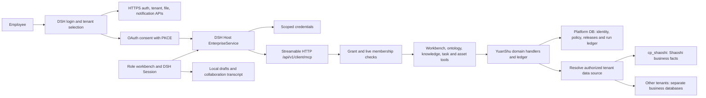
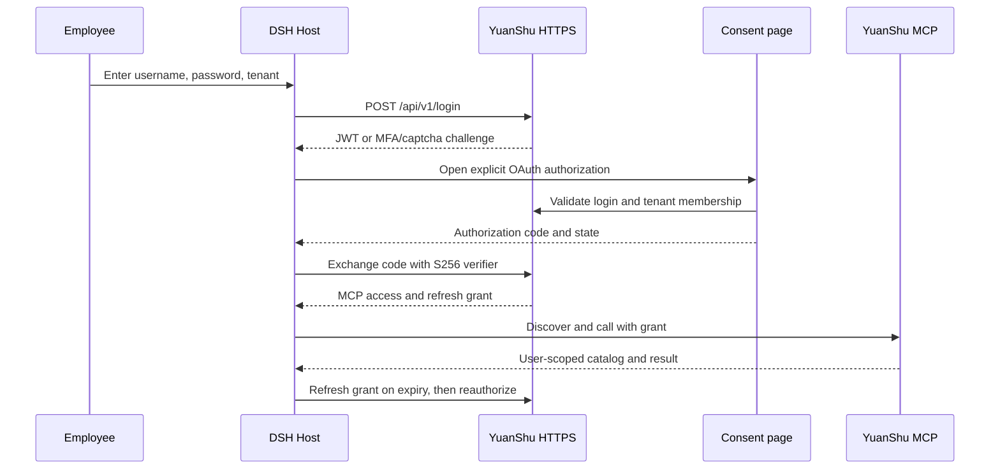

# 少仕元枢工作台集成设计

[English](integration-design.md) | 中文

本文是[产品与界面设计](design.zh.md)的工程配套文档，记录已经从元枢源码核实的能力、少仕租户中观察到的事实、DSH 插件应负责的内容，以及正式接入前必须确认的事项。本文是设计提案，不代表集成已经部署。

## 1. 设计决策

首发优先打通项目经理的交付风险场景。元枢通过 HTTPS 提供身份、文件和事件投递，通过员工 MCP 提供工作台投影、语义查询、方法资料和受治理执行。DSH 使用原生 Session、MCP 和 Subagent 主持岗位工作，具体复用方式见第 10 节。

1. DSH 是面向少仕员工的专用客户端。登录后默认进入当前员工的元枢工作台，同时通过明确的返回入口保留原始 DSH 界面。
2. 正式数据路径是由 Host 持有、按用户隔离的 MCP 客户端，调用 `/api/v1/client/mcp`。浏览器不持有 MCP refresh token，插件不直接连接 PostgreSQL。
3. 登录、租户初始化、文件传输、健康检查和现有通知通道继续使用 HTTP。受治理的业务上下文、工作台投影、知识、本体、专业能力和长任务使用 MCP。
4. Tool 是一个操作；MCP 是发现和调用 Tools、Resources 的协议。DSH 原生 Tool 可以把本地状态和已授权的平台调用编排成面向工作的操作，但不为每个 MCP Tool 创建重复薄封装。
5. 元枢统一提供身份、权限、业务读取和执行入口；平台主库管理通用治理与运行记录，各租户业务库保存本租户业务事实。DSH 负责界面、草稿、模型协作和可恢复的 UI 状态。
6. 岗位视角由平台有效角色和租户显式映射共同决定。岗位名称、KPI 标签或客户端菜单不能授予权限，也不能推断用户权限。
7. 每个有影响的写操作都要有幂等键；异步操作要有不透明的 `task_ref`、明确结果和恢复路径。界面确认不等于审批，HTTP 200 不等于业务成功。

## 2. 证据范围与可信度

本次检查了 `/Users/david/Documents/project/cp_project/cp_project` 下的元枢源码，包括 Go 服务端和 Vue 客户端。源码仓库处于 `main`，比 `origin/main` 多三个提交，并有与本任务无关的未提交修改。没有修改源码、迁移、环境文件、生产配置或数据库行；因此源码反映的是检查时的实现，不一定等于部署中的服务。

早先的只读审计记录将 `go_admin_kit.public` 用于少仕租户（`shaoshi`）的岗位和平台数据核对。该记录不是少仕业务库的验证。本版按用户确认的架构，将独立 PostgreSQL 库 `cp_shaoshi` 作为少仕业务库；平台源码仓库的职责分析与业务迁移文件也区分了两库。本版查阅源码和迁移，没有连接数据库或核实部署目录。以下为早先审计运行的定向源码测试：

```text
go test ./internal/clientmcp ./internal/tenantaccess
```

两个测试均通过。这不能证明已部署端点、真实 OAuth 客户端、生产数据库或在线租户流程可用。

下方以 `server/` 开头的源码路径相对于 `/Users/david/Documents/project/cp_project/cp_project`；行号是复核锚点，源码变化后需要刷新。

## 3. 总体架构



只有 Host 服务持有 MCP 连接。界面通过类型化 Remote/Resource 服务访问；面向模型的工具只获得当前选中且已授权的能力。平台在目录可见性和执行时都会再次授权；客户端不能把发现结果当作权限缓存。

## 4. 元枢已经具备的能力

### 4.1 HTTP 入口

`server/internal/api/auth/routes.go` 中的公开登录路由包括 `GET /api/v1/login/tenants`、`POST /api/v1/login`、`POST /api/v1/login/2fa/verify`、`POST /api/v1/refresh`、验证码路由和 `POST /api/v1/logout`。受保护的用户路由包括 `GET /api/v1/auth/me`、`GET /api/v1/user/me`、`GET /api/v1/user/tenants`、`POST /api/v1/user/tenant` 和 `GET /api/v1/user/menus`。控制台登录是另一套接口，不能当作员工租户登录。

`server/internal/service/auth/user.go:66` 的 `LoginRequest` 接受 `username`、`password`、可选 `tenant_code` 和可选验证码字段。响应可能包含用户、access token、refresh token、租户代码或 TOTP challenge。`server/internal/api/auth/user_dto.go` 中的 `UserInfoResponse` 包含角色和权限，但不包含少仕业务岗位或 KPI 分配。因此认证之后仍需通过已授权的平台投影读取岗位和工作包。

现有通知 ticket 和 WebSocket 路由由 `server/internal/api/routes_system.go` 与 `server/internal/api/routes_auth.go` 挂载。它们可以传递平台通知，但通知流不是持久化工作群会话，也不是执行事件日志。

### 4.2 统一员工 MCP

当客户端 MCP 配置启用时，`server/internal/api/client_mcp.go:270` 将服务挂载在 `POST/GET /api/v1/client/mcp`。服务端在 `server/internal/clientmcp/server.go` 使用官方 Go MCP SDK 的 Streamable HTTP handler 和无状态运行方式。目录由显式操作、数据库能力、已发布资产、工作台适配器、本体、知识和任务操作组成，不是 `mcp_tool_registry` 的直接导出。

`server/internal/clientmcp/oauth.go` 使用协议版本 `2026-07-28`，进行 issuer/resource/client/redirect 精确校验，使用 Authorization Code + S256 PKCE、read 或 read-plus-execute scope、五分钟授权码、refresh pair 轮换，并在每次请求检查租户成员资格。普通 JWT 和 service key 会被拒绝为 MCP access token。`server/internal/clientmcp/consent.go` 的同意页可以提交平台登录，但当前页面不能完成 MFA/验证码分支；正式 DSH 必须为该分支提供回到平台登录的清晰流程。

`/api/v1/mcp/catalog` 是只读的管理目录预览，`/dap/mcp` 是管理/测试页面，二者都不是 DSH 的执行端点。旧的独立 DAP SSE 是兼容路径，不是员工接入路径。

### 4.3 工作台和业务能力

`server/internal/api/client_mcp_workbench.go` 提供 `workbench_describe`、`workbench_profile`、`workbench_home`、`workbench_position`、`workbench_positions`、`workbench_briefing`、`workbench_decisions`、`workbench_navigator` 和 `workbench_records`。这些是工作台确定性读取的首选能力，输入受到岗位、领域、页码、关键词和状态范围约束，不暴露任意路由或数据库名称。

`server/internal/api/client_mcp_operations.go` 提供目录和场景操作、本体读取、知识搜索与会话、Action 的预检/请求/审批/执行/查询、固定版本的 algorithm/skill/DAG 执行、Agent 委托和场景运行，并记录兼容别名及替代能力。已发布资产只能在固定版本和当前 grant 具备执行权时运行。

`server/internal/api/client_mcp_tasks.go` 统一 task、execution、workflow、scenario 和 action 记录。`task_ref` 是平台记录的不透明定位符；`task_get`、result、events、cancel、resume、approval 和 available-operation 字段构成恢复接口。未知状态在核实前都不是终态。审批引用由平台审批权决定，用户点击确认不能代替审批人。

`server/internal/clientmcp/contracts/business-result.schema.json` 是结果权威定义，区分 `accepted`、`input_required`、`succeeded`、`failed`、`cancelled`、`rejected`、`timed_out` 和 `unknown`，保留 task 引用及原始数据，并要求稳定的重试指引。DSH 界面必须保留这些差异。

### 4.4 数据库能力

`server/internal/api/client_mcp_database.go` 只暴露 DAP 目录中启用且合法的数据库处理器。只读查询有 `limit <= 1000`、`max_rows <= 10000`、`timeout <= 120s` 等限制，调用者不能传入 user 或 tenant actor key。普通员工应优先使用本体和工作台投影，而不是原始 SQL 和 schema 工具。数据库目录条目是实现能力，不等于可以把全部业务数据交给模型。

### 4.5 租户业务库与员工可见数据目录

元枢主库保存身份、租户成员、岗位与权限、数据源注册与凭据引用、已发布本体及映射、知识和平台运行审计。少仕的项目、采购、研发、制造、质量、交付及财务事实留在 `cp_shaoshi`，少仕专用业务表和业务迁移由少仕应用维护。主库可保存受控业务引用、投影与证据版本，避免复制业务事实作为另一份权威数据。源码依据为 `server/docs/少仕数据库与元枢平台数据职责边界分析-20261109.md` 和 `server/sql/shaoshi/migrations/202610290001_shaoshi_business_tables.sql`；迁移清单不是已部署 MCP 目录。

平台管理侧通过管理 API 登记租户数据源、测试连接、扫描结构、审核字段分类、绑定本体和发布目录。员工 grant 验证后，服务端根据已认证租户解析数据源注册，按租户和数据源隔离连接池，读取使用最小权限只读账号。员工请求只接受平台发放的逻辑引用；不接受数据库名、连接串、任意 schema 或租户覆盖值。没有绑定、绑定不唯一或数据源不可用时返回明确状态，禁止回退到主库或其他租户。业务写入经领域服务执行；它独立校验业务归属、记录版本和放行条件。

员工 MCP 首期使用同一 `/api/v1/client/mcp`，不要求每租户部署一个 MCP 服务。以下逻辑名称是建议，须与现有 DAP Tool 和本体接口对齐后发布。普通员工可发现岗位允许的业务表或视图及安全字段信息；物理拓扑、全库扫描和高级查询仅面向经批准的数据岗位。

| 建议的 MCP 能力 | 输入与输出 | 谁使用 |
|---|---|---|
| Tool `tenant_data_list_objects` | 领域、类型、分页游标 → 不透明 `object_ref`、表/视图逻辑名、业务说明、可用操作和目录版本 | 工作台数据导航；Agent 按工作需要定位来源 |
| Tool `tenant_data_describe_object` / 版本化数据字典 Resource | `object_ref`、可选版本 → 授权列、类型、单位、空值语义、枚举、允许筛选项、业务键、可展示关系和本体绑定 | 图表、表格、SOP 取证；Resource 可引用，读取时重新授权 |
| Tool `tenant_data_query_records` | `object_ref`、授权字段、类型化过滤和排序、游标 → 授权记录、记录引用、来源版本与数据时间 | 确定性页面、指标明细和 Agent 取证；聚合默认使用已发布指标 |
| 已发布本体 Resource 与本体上下文/查询/证据 Tools | 本体发布引用、类、关系或业务对象引用 → 授权概念、关系路径、关联业务记录和证据定位 | Agent 解释依赖与影响；DSH 展示可以回查的业务引用 |

先应用对象和字段策略，再返回目录、描述或本体字典；执行时重查当前权限，并把行范围落实到过滤、关联和聚合，禁止通过计数、外键、列注释或错误推断隐藏数据。服务端限制页大小、查询复杂度、执行时间和响应字节；不提供普通员工任意 SQL。没有权限的对象与不存在的对象统一响应；授权对象的数据源不可用或映射失效时，返回可区分的错误，不把空结果展示成无风险。游标绑定查询、租户、主体、权限和目录版本；版本变更后丢弃旧游标并重新发现。

建议由平台维护 `本体发布版本 → 类/关系 → 对象与字段映射 → 记录/证据引用`，在目录登记稳定逻辑 ID 和数据负责人。先验证迁移与字段映射，再切换本体发布；发生不兼容漂移时停止相关调用并标为待修复。DSH 依授权主体、租户及目录版本缓存，租户切换、权限变化和撤销时清除可用缓存；会话历史、fork 与证据再读取继续执行第 10 节的权限和留存规则。审计记录主体、数据源逻辑标识、对象、映射版本、操作和结果摘要，避免把敏感行内容写入通用审计。

少仕首发可从迁移中选 `prj_projects`、`prj_project_milestones` 和 `prj_project_risks` 做受控投影，发布“项目包含里程碑、风险影响里程碑”的语义映射；关系以已核实的键或显式映射为准。项目经理从风险通知打开工作台，Host 查询可见里程碑和证据，原生对话按需读取本体与记录。先在业务库提交风险变更和业务事件，再由平台按事件 ID 去重、筛选合法接收人并投递；跨库可靠投递需业务 outbox 或经验证的 CDC，主库通知不替代原业务提交。

## 5. API、MCP 与 Tool 的分工

| 能力 | 接口 | 原因与责任方 |
|---|---|---|
| 用户名密码、租户列表、MFA/验证码、刷新、退出 | 元枢 HTTPS API | 交互式身份和令牌生命周期；DSH Host 负责衔接，元枢验证身份。 |
| 当前用户、菜单、租户成员资格和连接健康 | HTTPS API，再读取 MCP 身份/工作台投影 | 启动契约需要确定性；业务上下文必须在 grant 作用域中读取。 |
| OAuth 发现、同意、token、revoke | HTTPS OAuth 端点 | MCP 传输授权；不能替换成平台 JWT。 |
| 工作台首页、profile、岗位、简报、决策、导航、记录 | MCP `workbench_*` Tools | 已有受治理投影；Host 可以确定性调用供 UI 使用。 |
| 本体空间、集合、发布、上下文、查询、证据 | MCP Tools/Resources | 版本化、受治理的语义读取；模型可选择范围明确的操作。 |
| 知识搜索、回答、文档、集合和会话 | MCP Tools/Resources | 带来源的 AI 上下文，带引用和敏感度检查。 |
| 已发布 Skill、Algorithm、DAG 执行 | MCP Tools | 使用平台账本、审批和固定版本的长任务。 |
| task、execution、workflow、scenario、action 恢复 | MCP `task_*` Tools | 为不同运行类型提供同一恢复词汇。 |
| 文件上传/下载和受控导出 | HTTPS API 或专用文件服务 | 大型二进制传输和留存放在模型工具之外更清晰。 |
| 平台通知和通知 ticket/WebSocket | 现有 HTTPS 与 WebSocket | 只提供提醒；权威来源仍是元枢通知或业务记录。 |
| 创建持久工作群、成员、消息和历史 | 需要新增平台能力 | 现有通知和会议表不能证明已有群聊 API，不能在 DSH 本地另造共享事实。 |
| DSH 草稿、附件选择、提示上下文和本地界面状态 | DSH Session/存储 | 本地协作状态，不能冒充平台审批或业务提交。 |
| 多次读取组成的岗位简报或带引用草稿 | DSH 原生 Tool 编排选定 MCP 调用 | 只有在确实减少模型规划成本时使用，保留来源 ID，不能声称写入成功。 |

规则是：控制面和传输层中需要客户端确定性调用的内容使用 API；需要被发现、有 schema、有版本、有审计或可由助手选择的业务能力使用 MCP Tool；稳定的只读上下文使用 MCP Resource；只有 DSH 自己的编排才新增 DSH Tool。API 和 MCP 都必须调用同一套元枢处理器和授权策略。

### 5.1 元枢建议的具体暴露契约

下面是第一版可以执行的分工。“MCP Tool”不表示必须让语言模型选择这个操作：DSH Host 可以为了渲染界面确定性调用同一个 Tool，模型只接收当前工作所需的已筛选能力。

| 元枢能力族 | 暴露为 HTTP API | 暴露为 MCP Tool 或 Resource | DSH 使用方式 |
|---|---|---|---|
| 身份启动 | `GET /api/v1/login/tenants`、`POST /api/v1/login`、MFA/验证码校验、`POST /api/v1/refresh`、退出、`GET /api/v1/user/me`、`GET /api/v1/user/tenants`、租户切换 | 不把密码登录暴露成 Tool；通过 `workbench_profile` 或专用读取投影暴露已建立的隔离身份 | Host 执行登录和 OAuth 同意；界面接收类型化身份状态。 |
| MCP 授权 | OAuth discovery、authorize、token、revoke 和 protected-resource 元数据 | 不重复创建登录 Tool | Host 负责 PKCE、刷新轮换、撤销和 grant 分区。 |
| 工作台读取 | 健康检查/就绪检查、静态客户端配置和大文件传输 | `workbench_describe`、`workbench_profile`、`workbench_home`、`workbench_position`、`workbench_positions`、`workbench_briefing`、`workbench_decisions`、`workbench_navigator`、`workbench_records` | Host 直接调用 Tool 生成确定性面板；模型可以使用选定投影解释和排序。 |
| 语义业务读取 | 不为每一张岗位卡片另造端点 | 本体空间/集合/发布/上下文/查询/证据 Tool；有界对象查询；知识 search/ask/document/collection/session Tool；稳定发布文档作为 Resource | Host 渲染带来源的数据；模型使用带引用的有界读取。 |
| 方法和 SOP | 作者、发布者需要时使用管理 CRUD | 已发布 Skill/SOP/配方作为带版本 Resource；`scenarios_list` 或读取 Tool 获取适用性 | 界面显示节点和方法版本；执行仍然是平台 Run。 |
| 明确业务写入 | 只有稳定表单、属于应用控制面的操作才使用类型化 API，例如少量配置或租户设置更新 | 领域写入、提案、Action 预检/请求/审批/执行、场景运行、已发布 Skill/Algorithm/DAG 执行使用范围明确的 Tool | 用户从可见阶段发起；Host 提供 schema、版本、幂等键和确认。 |
| 长任务 | 只有平台本身要求时才保留健康或管理取消 API | `task_get`、`task_result`、`task_events`、`task_cancel`、`task_resume`、`task_approvals`、`task_approve` | 所有 Run 使用同一套恢复词汇；不在 DSH 创建第二任务账本。 |
| 文件 | 上传/下载、分段传输、病毒扫描、留存和导出 | Tool 可以创建或定位文件引用，但不应把任意二进制通过模型上下文传输；文件元数据可以是 Resource | Host 传输字节，只把作用域引用交给模型。 |
| 通知 | ticket 签发和 WebSocket/SSE 投递 | 可以有读取来源通知的 Tool；投递本身不是 Tool | DSH 把通知变成关联源记录的助理信号。 |
| 工作群和日程 | 元枢定义成员、消息、会议和历史语义后使用 CRUD API | 有受治理契约后，使用 `workgroup_*`、`calendar_*` Tool 做助手搜索、议程准备和任务关联；消息历史作为分页 Resource | 在此之前显示未接入状态，不能在 DSH 建立共享事实。 |
| 原始数据库访问 | 保留在内部 DAP API 和策略控制之后 | 只向管理员或批准的数据岗位暴露明确启用、只读、有界的数据库 Tool；普通员工默认不开放 schema/query | 优先使用工作台和本体投影。 |

平台不应为每张岗位仪表卡、KPI 卡片或助理建议创建单独 REST 端点，它们应是受治理工作台和本体数据的投影。平台也不应把原始 `mcp_tool_registry` 行直接作为客户目录；统一目录必须在列出或调用前应用租户投影、岗位权限、schema、版本和执行策略。

### 5.2 MCP Tool 准入规则

只有同时具备稳定名称、JSON schema、从 grant 推导租户与主体、明确读写标记、权限校验、有界输入输出、结构化错误、审计行为以及版本或 revision 规则的操作，才进入客户 MCP 目录。写操作还必须有幂等标识和可查询的任务或结果引用。仅属于界面传输细节、凭据交换、二进制流或平台管理的操作继续使用 HTTP。

DSH Host 必须把发现到的每个 Tool 当作不可信的能力元数据，重新检查当前 grant、输入 schema、版本和允许操作后才能调用。Tool 可以供 UI 使用而不必暴露给模型；暴露给模型也不会授予权限或替代人工审批。

### 5.3 Agent 优先的主动工作闭环

目标体验是“工作主动找人”，而不是等待人打开菜单搜索。第一版应实现以下闭环：

1. 平台通知、业务变更流、定时检查点、逾期阈值或新任务进入 DSH Host。投递可以使用现有通知 ticket/WebSocket，或新增持久事件流 API。MCP catalog subscription 只描述能力目录变化，不能当作持久业务事件保证。
2. 岗位 Agent 使用当前用户的租户、有效角色、岗位映射、KPI 状态、负责人、截止时间、严重度和新鲜度判断相关性，记录选中原因，并按源记录和事件版本去重。
3. Agent 调用有界的 `workbench_*`、本体、知识和任务 Tool 组装证据，加载适用的 SOP/Skill Resource，形成包含事实、缺口、风险、建议下一步和置信度的结构化工作简报。
4. Agent 准备草稿、检查清单、议程、对比或升级建议。准备可以自动完成；对外发送、业务变更、提交审批和执行必须经过可见确认或平台审批。
5. Host 保存来源引用、方法版本、证据引用、草稿版本、等待人的决定和 `task_ref`，向员工显示一项可行动的助理事项，而不是一组无法解释的告警。
6. 用户确认后，Agent 使用幂等键和版本调用范围明确的 MCP 写 Tool，跟踪原任务直到验证终态，并把失败或新增输入带回员工。

这说明 API 与 MCP 是互补关系：HTTP/事件投递唤醒 Agent，MCP 读取和 Tool 让它理解与执行，DSH Session 让员工看懂并参与。可以先用 DSH 定时调度作为过渡，但生产规模需要持久的平台事件源、游标、重放窗口、租户过滤和去重契约。

### 5.4 按元枢领域设计能力暴露

运行时目录应按生命周期阶段暴露能力。管理和发布可以保留在元枢已认证的管理 API 中；DSH 客户端只能从 MCP 目录收到已经发布、按租户隔离的运行时能力。

| 领域 | 运行时发现 | 读取/上下文界面 | 执行界面 | 结果与治理 |
|---|---|---|---|---|
| 本体 | `ontology_overview`、`ontology_spaces`、`ontology_collections`、`ontology_releases` | `ontology_context` 返回固定发布版本的对象类型、字段、关系、规则和支持的查询操作；`ontology_evidence` 返回运行审计证据 | `ontology_query` 调用语义规划器，`ontology_objects_query` 查询已声明的对象字段、过滤器、链接和分页 | 每次调用都要求 consumer binding、release ID、行策略和权限；禁止任意 SQL 和调用方自带租户/主体身份。 |
| Skill | 目录返回已发布状态、交互模式、暴露方式和版本 | Resource `yuanshu://skills/{id}/{revision}`，或只读 `skill_<name>` 读取冻结的 `SKILL.md` 及相对引用 | 只有已发布且可执行的 Skill 才生成固定版本和幂等键要求的 `skill_<id>_execute` Tool | 指令型 Skill 是上下文，不是代码执行；客户端不能执行容器命令，也不能把 Skill 文档当权限授予。 |
| 算法 | 已发布资产的元数据、输入输出 schema、负责人、版本、敏感度和允许租户 | 通过目录/Resource 获取 schema 和方法元数据，大型产物保留为文件引用 | 动态 `algorithm_<id>_execute` Tool，要求目录版本和幂等键 | 校验资产权限、输入限制、数据范围、审批策略和任务账本；模型不能选择未发布或可变版本。 |
| 专业 Agent | `scenarios_list` 和已发布 Agent/场景绑定返回不可变目标版本及输入能力 | 读取绑定、方法、输入要求和能力说明；不暴露隐藏 prompt 或服务端身份 | `agent_delegate` 执行明确子任务，或 `scenario_run` 执行已发布场景；服务端选择 DSH 目标并返回子 Run | 调用方只能提供关联字段；平台选择目标身份/策略，复核版本和所有权，并返回 `run_id`/`task_ref`；DSH 仍是顶层编排者。 |
| DAG/工作流 | 已发布工作流目录、`dag_history` 和有权访问的运行元数据 | `yuanshu://workflows/{id}` 或 `yuanshu://runs/{id}` 读取有权的定义、输入、检查点和结果 | 动态 `dag_<id>_execute` Tool；旧 `dag_run_*` 保留兼容别名，主路径使用 `task_*` | 固定版本、冻结输入、执行审批和检查点规则；恢复必须提供原检查点、待执行动作、审批和幂等键。 |
| 场景 | `scenarios_list` 与 `scenario_bindings_list` 返回已发布/部署场景 | 绑定和方法说明、所需材料、预期结果及允许操作 | `scenario_run`；取消/事件/结果使用统一 `task_*` 层 | 场景是已发布业务配方，不是第二层 Agent 包装；平台已经返回 Run 时不在 DSH 另建任务。 |
| Action 与审批 | `approvals_list` 和 Action 能力元数据 | `action_preflight` 说明目标、版本、影响、必填项和审批路径 | `action_request`、`action_approve`、`action_execute`、`action_get`；`task_approve` 只暴露给指定审批人 | 分开员工确认、委托执行 scope 和指定审批人权限；每个写操作都要幂等和审计。 |
| 知识 | `knowledge_collections`、就绪状态和当前用户的会话列表 | `knowledge_search`、`knowledge_ask`、`knowledge_document`、会话轮次，以及文档/集合 Resource | 普通员工不提供通用“写知识” Tool；采集和发布走管理 API 或受治理流程 | 保留引用、敏感度、集合范围和未就绪状态；知识回答没有来源证据时不能成为业务事实。 |
| 工作台 | `workbench_describe`、profile 和分区元数据 | `workbench_home`、`workbench_position`、`workbench_positions`、`workbench_briefing`、`workbench_decisions`、`workbench_navigator`、`workbench_records` | 工作台读取不直接改变业务状态；写入转到领域 Action、场景、Skill、算法或 DAG Tool | 工作台投影是岗位视图，不是权限系统；平台每次读取都重新检查范围。 |
| 数据库/DAP | 只发现白名单中启用的企业数据库处理器 | 为批准岗位提供数据源、schema 和元数据 Tool，以及有界只读查询 Tool | 不提供通用写 SQL Tool；修改使用领域操作或受治理资产 | 校验数据源权限、只读策略、行数/超时/大小上限，并注入推导出的租户/用户上下文。 |

客户端应把这些能力呈现为四个员工阶段：**理解**（工作台、本体、知识、Resources）、**准备**（Skill、Agent、场景和 DSH 草稿）、**执行**（Action、算法、Skill、DAG 和场景 Tool）、**核实**（`task_*`、证据、产物和审计）。目录可以有更多名称，但界面和模型只能看到符合当前阶段、经过权限过滤的子集。

### 5.5 元枢应暴露为管理 API 的内容

元枢仍需要管理 API，供管理员和发布者创建、复核、发布、下线和回滚本体发布版本、Skill、算法、Agent 定义、DAG、场景、绑定、Action 类型、消费者策略、事件订阅和工作台映射。这些 API 不应作为无限制 CRUD Tool 复制到员工 MCP 目录。员工运行时只接收不可变的已发布版本，并通过运行时 MCP 契约调用。

每个已发布能力的管理 API 都必须生成 manifest，至少包含：稳定 ID、版本 ID、状态、租户和数据范围、输入输出 schema、读写效果、所需权限、审批策略、敏感度、超时/预算、支持的恢复操作、来源证据、负责人及弃用/替代元数据。MCP 发现只发布该 manifest 的投影，执行时还要重新校验。

## 6. 身份、租户、岗位和 KPI 模型

身份链是“平台用户 -> 当前租户成员资格 -> 有效角色 ID -> 工作包映射”。`sys_positions` 与 `sys_user_positions` 是平台身份/权限主数据（`server/internal/model/position.go:9-100`）。少仕业务库的 `pos_positions` 保存业务岗位描述、关联场景、SOP 代码、Agent 绑定代码和 KPI 描述。`server/internal/apps/shaoshi/position_scenarios.go:43-121` 当前只消费 `pos_positions` 的场景关联，没有用它选择认证用户的工作台。

当前少仕 profile 按有效角色权限从八个工作包中选择（`server/internal/apps/shaoshi/profile.go:286-325`、`position.go:50-184`）：`project-execution`、`procurement`、`quality`、`engineering`、`finance`、`management-dashboard`、`tenant-admin` 和 `it-data`。源码没有证明这八个包和租户 18 个有效岗位一一对应。应增加租户拥有、带版本的映射：主岗位、兼岗、数据范围、默认工作包、岗位 ID、生效期和审核人，严禁模糊匹配岗位名称。

只读检查发现 18 个有效未删除岗位和 200 条当前 KPI。200 条 KPI 的 `review_status` 全部为 `unreviewed`；模式为自动 45、半自动 101、手动 54。检查快照中公式均为空，33 条方向未知，3 条基线待补。项目管理岗位没有 KPI 行。这些是配置状态，不是实际达成结果。

必须分开显示三种内容：

| 内容 | 含义 | 界面规则 |
|---|---|---|
| 运营简报 | 逾期决策、延迟采购、检验积压、开放质量异常等计数（`briefing.go:202-302`） | 作为带来源和新鲜度的工作信号显示。 |
| 岗位 KPI 定义 | 目标、周期、持有人、数据源模式、复核和版本（`sys_position_kpis`） | 显示配置状态，不从缺失公式推导。 |
| 个人 KPI 结果 | 以租户、岗位、KPI UID、持有人和周期为键的 `shaoshi_kpi_results` | 取不到显示未取数，不能用零代替。 |

第一版需要业务负责人审核 18 行岗位映射。当前源码支持八个宽泛工作包，但没有证明每个岗位都有完整的个人图表、日常 SOP、Agent 绑定或可执行 KPI 计算。

## 7. 岗位工作台与公共工作

所有岗位使用同一条公共主线：助理收件箱、高频工作场景、SOP、当前工作、工作群、日程、通知、结果，以及返回原始 DSH。岗位区域改变证据、图表、方法和主操作；公共功能保持稳定的菜单位置。

助理收件箱以数据为入口。每项信息包含来源记录、新鲜度、影响原因、负责人、截止时间、阶段、下一位处理人和允许操作。缺失来源显示“未接入”“需人工确认”或“定义待补”，不能只因为岗位名称而升级成告警。

高频场景是平台发布的工作配方，不是静态客户端卡片。配方定义适用条件、输入、SOP 步骤、输出、引用、复核标准、禁止假设和合格样例。界面用节点显示“收集、检查、分析、起草、复核、审批、执行、验证”；平台 DAG 或 workflow 负责执行，DSH 负责展示并协助完成方法。

工作群属于待补的平台能力。一个工作群可以围绕项目或督办事项建立，包含人员和明确邀请的岗位 Agent，保存消息与决策，并把每个动作关联到元枢任务或记录。通知可以提醒成员，但不能替代群历史。在平台提供群接口/MCP Tool 前，原型必须标记为演示数据，不能暗示已有共享持久化。

有授权投影后，日程和每日计划读取平台会议/行动记录。源码中确实有会议和协同表，但检查到的少仕路由没有将它们作为工作台产品暴露。数据库有表不等于有 API。第一版可以显示明确标注的空状态或待接入状态。

<a id="scene-continuity"></a>
### 7.1 场景持续工作与助理成长

参考[《DSH搭建AI工作台：赛博自己养成记》](https://www.toutiao.com/video/7708098744563745331/)（约 12 分 20 秒）。本次读取覆盖逐秒画面字幕 OCR 和周期性完整画面文字，没有音频转写；时间点用于复核，识别可能有误差。下表把作者展示或描述的个人工作台方法转化为少仕的设计要求，不代表 DSH 或元枢已经具备这些实现。

| 视频位置与方法 | 元枢工作台设计要求 | 用户看到的结果 |
|---|---|---|
| 01:32–02:57 场景记忆、交接和索引 | 每个场景实例保存经授权的业务引用、当前阶段、材料版本、未决问题、下一步、方法版本和任务引用；摘要限额与归档策略可配置，详细材料按索引检索。 | 次日登录直接看到“上次做到哪里、还缺什么、接下来做什么”。 |
| 03:02–03:55 身份与会话绑定 | 显式绑定租户、主体、岗位、场景实例和 DSH Session；绑定时重新授权，不通过聊天标题推断身份。 | 每项工作显示当前身份；跨岗位接手可追溯，不能串用上下文。 |
| 04:04–05:51 面板与界面感知 | 场景按需组合流程、材料、成果和对话；向助理提供当前记录、选中片段、版本及允许动作等结构化上下文，并记录模型实际看到的内容。 | 用户选中一项异常即可要求分析或起草，无需反复复制材料。 |
| 04:29–04:55、06:00–06:18、07:27–07:43 协作与规则 | 主助理明确委托专业 Agent；派单包含目标、输入引用、交付物、预算和截止时间。由执行层限制费用、时长、并发和委托层数，防止消息互相触发；写入校验记录版本。 | 工作群展示谁在做什么、等待谁、产出了什么；同一业务变更只有一个权威结果。 |
| 06:23–07:22 经验沉淀为技能 | 复盘生成带案例、来源和适用范围的方法改进草稿；业务负责人复核后发布固定版本。技能先加载摘要，执行时才取正文；个人偏好不能修改公司 SOP 或权限。 | 助理记得用户确认过的工作偏好，岗位方法改进可以审阅、追溯和撤回。 |
| 07:52–08:41 标准化与按需扩展 | 岗位工作包声明场景、视图、方法引用和能力依赖；只启用当前工作所需且已授权的插件、工具和资产。 | 不同岗位使用相同交互规则，看到各自材料和动作；新岗位可复用配方。 |
| 08:53–09:56、11:18–11:32 个人理解与持续积累 | 个人偏好、项目记忆和公司知识分别管理，提供来源、作用域、保留期及更正/删除入口；仅收集经明确授权且与工作有关的信息。 | 助理逐渐适应用户认可的工作方式，用户能查看并修正它记住的内容。 |
| 10:36–10:56 工作台体检 | 检查授权、来源新鲜度、记忆索引、方法版本、执行依赖和待核实结果；只推送会阻碍当前工作的异常，并给出修复入口。 | 首页说明“可继续”“缺材料”“需授权”或“需核实”，不增加独立的重复菜单。 |

场景实例的持久化归属需要在实现前确认：业务阶段、审批和执行结果仍归元枢；DSH 只保存有主体作用域的交接摘要、草稿与引用。恢复时先核实权限、来源版本和 `task_ref`，过期摘要不得覆盖新记录。客户端状态必须采用正式插件服务和持久化扩展点，不另建一个以共享 Markdown 充当业务数据库的系统。

原型下一轮优先验证三条路径：①首页工作信号→场景实例→助理预备材料→人工复核；②关闭再打开同一工作→显示交接摘要→核实任务→继续当前步骤；③工作群委托→专业 Agent 交付→负责人确认→关联原任务。以采购延期为例，助理汇总采购与交付证据，拟定供应商跟进和生产影响说明，再由有权限的人确认后发起平台操作。该例是待业务确认的验收场景，不代表当前已连通。

验收必须覆盖：恢复后没有重复提交；换租户后不能读取旧材料；材料版本变化会使草稿显示待复核；预算耗尽后停止派单；无新证据的同一异常不会重复提醒；记忆更正与方法发布有审计记录。事件投递、跨设备场景同步、群历史、委托预算和记忆治理都需要明确服务端负责人，不能仅靠提示词保证。

## 8. 登录和 OAuth 时序



平台 JWT 是同意流程的凭据和启动身份，不是 MCP access token。凭据由 Host credential service 按 issuer、resource、client、tenant、principal 和 Session 作用域保存。切换租户或主体时，先销毁旧 client、目录和任务句柄，再加载新作用域。MFA/验证码必须回到平台流程，不能静默使用无作用域客户端。

元枢源码已有 `POST /api/v1/mcp/oauth/preauthorize`。Host 可在登录成功后用平台 JWT 发起预授权，但仅限租户已批准的客户端及 `enterprise:read`。成功返回授权码回调地址，Host 仍须校验 state 并用 PKCE 换取 MCP grant；返回 `consent_required` 时进入显式同意流程。部署配置尚未核实。平台 HTTP 会话、DSH 浏览器 Cookie 与 MCP grant 各自失效；退出验收须分别验证，浏览器登出不代表远端 grant 已撤销。

## 9. 任务执行与恢复

1. 用户在明确的工作阶段选择操作。DSH 检查当前目录 schema、目标版本和确认要求。
2. Host 带平台要求的幂等键调用 MCP，并在渲染进度前保存返回的 `task_ref`。
3. `accepted` 表示平台接收请求，不代表工作完成。DSH 继续使用 `task_get`、`task_events`、`task_result` 和 `available_operations`。
4. `input_required` 保留原任务并收集声明的字段，不能创建替代任务或授予审批权。
5. 待审批状态显示审批人、审批引用和允许操作。`task_approve` 需要平台审批权限。
6. 获取 `task_ref` 前超时，进入“提交结果待核实”，按幂等键或平台账本查询，在结果明确前阻止重复提交。
7. 重启后按主体作用域读取保存的任务引用并核实，不能因为传输断开而重放 Tool 调用。
8. 只有平台终态结果才能标记业务完成或取消，并保留原结果、错误码、来源和审计链接。

本地 Session 可以保存摘要、选中材料、游标和显示状态，不能变成第二套任务账本、审批账本或工作群事实来源。

## 10. DSH 插件规范与复用

`dev` 中的 `yuanshu-workbench` 仍是以合成记录为主的 UI 原型，但 Host `src/index.ts` 已注册可选的 Streamable HTTP MCP 连接和 DSH 原生 MCP 账号入口；客户端 `src/client/index.ts` 已接入原生 Conversation、Session 引用和岗位工作台。当前 MCP 配置默认关闭，工作台业务数据仍来自本地 store。它的角色/视图/任务/工作群模型、fixtures、语言包和布局可以作为交互脚手架；在代表真实员工之前，必须把这些 store 读写替换为类型化 Host 调用，并让 MCP grant 与平台主体绑定。

`feature/yuanshu-platform` 包含可复用基础，但不能整体合并：

| 来源 | 复用决定 |
|---|---|
| `packages/yuanshu/yuanshu-client/src/mcp.ts` | 优先复用领域解析和协议测试；先验证原生 `mcpManager` 的发现、刷新、撤销和目录失效，只移植确认缺失的行为。同一连接只保留一套传输与授权生命周期。 |
| `packages/yuanshu/yuanshu-login-server` 与 `apps/yuanshu-login` | 复用登录页、TOTP 分支和外部身份标记。`/yuanshu-token` 是 DSH Host 的 Web 会话交接路由。平台 HTTP 会话凭据应移出 localStorage，MCP grant 单独存于 Host 凭据服务。 |
| `packages/yuanshu/yuanshu-tool/src/enterprise.ts` | 复用 Session 作用域的 EnterpriseService、typed Remote、资源注册和释放。 |
| `packages/yuanshu/yuanshu-gateway/src/routes.ts` | 复用显式路由白名单、方法限制、错误状态透传；不得把网关当通用代理，也不能把 console token map 当业务主体。 |
| `packages/yuanshu/yuanshu-gateway/src/index.ts` | 幂等键解析位于此文件，可单独移植。整体仅在需要同源 HTTP 迁移或兼容旧 Worker 时复用；正式 MCP 模式优先由 DSH `mcpManager` 直连 `/api/v1/client/mcp`，避免网关重复维护 OAuth 和主体映射。 |
| `packages/yuanshu/yuanshu-gateway` 的 `/workbench/*`、`/ontology/*`、`/scenarios`、`/skills/*`、`/algorithms/*`、`/dag/*` 路由 | 作为现有能力清单和兼容迁移依据；每个路由必须在元枢 MCP Tool/Resource 有等价契约后再切换，不能因为网关存在就宣称生产能力已可用。 |
| `ui-yuanshu-chat` 的资源和工作台组件 | 复用资源取消、任务恢复和岗位场景模式，重构界面及敏感存储。 |
| `packages/client/ui-yuanshu-account` | 复用设置入口、昵称/用户名展示和切换账号交互；退出必须同时撤销 DSH 浏览器会话、元枢 access/refresh grant 和本地缓存。 |
| `packages/yuanshu/yuanshu-client/tests/mcp-authorization.spec.ts` | 复用 OAuth 测试矩阵：租户 header、S256 PKCE、scope、issuer/resource 校验和 token endpoint 不带普通 JWT；上线前增加 MFA、撤销、刷新轮换和租户切换测试。 |
| 登录 launcher 与 localStorage token 代码 | 不作为 MCP 安全边界或 refresh token 存储直接复用。 |
| 旧 HTTP worker 调用 | 仅作为明确的迁移探针保留，不能静默从 MCP 回退到 HTTP。 |
| 原型 fixtures 和本地 save/submit | 只复用视觉状态；业务写入必须调用元枢并显示平台结果。 |

实现必须形成完整的 capability seam：服务定义、Host 提供者、UI/Agent 消费者。所有注册使用 `ctx.effect()` 或 `ctx.on()`。插件卸载、Session 释放、租户切换、目录失效和凭据撤销都必须停止请求、移除动态工具并释放资源。

### 10.1 原生能力与接入责任

| DSH 能力 | 元枢提供 | 插件如何使用 |
|---|---|---|
| MCP | 员工 MCP 地址、OAuth 元数据、授权目录、版本化资源和统一任务工具 | Host 复用 MCP manager/client、账户与凭据服务。按平台、租户和主体隔离连接及缓存。确定性页面消费类型化投影，Agent 仅按需加载当前场景允许的工具。先验证目标协议、回调和资源读取的兼容性。 |
| Upstream Skills | 公共方法提供固定 GitHub 提交、目录、许可、字节上限和摘要。租户私有 SOP 提供经授权的版本化 Resource，必要时提供受控文件下载。 | 公共方法由 Host 用 `ctx.upstreamSkills.register` 注册插件自带的入口 Skill，启动时下载并校验引用文件。私有 SOP 首期作为 Resource 按需读取。若要进入技能目录，新增按主体授权的 Skill provider。两条路径均冻结方法版本并记录实际送入模型的材料。 |
| 最近会话及工作区根目录 | 返回岗位、场景和可见业务对象引用。 | 悬浮入口继续该岗位最近会话，对话内提供新建和历史入口。复用原生 Session 标题、搜索和打开能力，按主体、租户、岗位、工作区筛选。根目录由用户在 DSH 工作区选择，平台文件通过附件或引用显式导入。 |
| 共享 fork 与草稿 | 重新验证源对象读权、记录版本和当前动作权限。 | 使用原生 fork 从已完成轮次派生审阅会话，共享历史前缀的能力取决于存储实现。多人共享需另行授予会话访问权限。子会话保留分析来源，单独保留草稿。平台任务、待确认写请求和审批均由原工作继续跟踪。 |
| 分页和断线恢复 | 提供 `task_ref`、当前状态和事件游标。 | 会话历史走原生 Session 分页和 follow。远程任务通过 `task_get` 和 `task_events` 对账，分别维护会话和平台游标。未提交草稿继续使用原生 Composer 草稿。 |
| Subagent | 提供可委派的专业能力、版本、输入权限、预算和结果。 | 使用原生 spawn 管理父子会话，通过 Host 当前设置选择允许的模型。给支持继续的子任务发送人类补充消息，一次性子任务可查报告。委派时声明任务范围、证据、交付物和报告指引，报告回到父会话。元枢专业 Agent 通过 `agent_delegate` 独立执行并返回平台任务引用。 |

本地子任务使用独立且受限的 preset，实际可用工具和文件范围由 Host 校验。运行中的模型路由与后续委派的选择分别处理，后者读取最新设置。原生父子关系与平台任务关联分别记录。工作台无须依赖 dsh-master 提供委派运行时。

### 10.2 项目经理交付风险纵切

1. 元枢推送里程碑风险信号。工作台按来源、版本和接收人去重，显示影响对象与截止时间。首次使用事件通知加定向读取，持久事件重放纳入后续接口验收。
2. 项目经理打开悬浮对话，进入项目工作区下的风险会话。DSH 用工作台投影定位记录，使用本体确认依赖与责任人，通过知识 Resource 读取证据，并装载固定版本的风险 SOP。
3. 父会话委派交期和质量核查。人可以给可继续的子会话补充客户约束。报告包含结论、证据引用、冲突和待确认项。需要平台计算时调用已发布算法，需要规范化执行时调用 DAG 或场景。
4. 父会话合并报告形成督办草稿。项目经理可从完成轮次 fork 审阅，回到原会话确认需求。平台根据 Action 预检结果、权限和审批策略接收提交。
5. 断线后从岗位历史打开原会话，恢复草稿和分析报告，并用原任务引用核实平台状态。结果页保留执行版本、证据与审计引用。

验收同时检查两条历史。DSH 可追溯用户沟通、草稿和子任务报告。元枢可追溯审批、执行和业务结果。撤销授权后阻断新增读取和调用，并按租户策略处理已持久化的本地材料。

当前原型点击“交给助理”时会在尝试发送后立即推进阶段，且复用会话不保证发送本次事项。首发验收必须首次和重复打开都验证具体事项进入原生对话。按租户、主体、场景和记录绑定会话；每次启动分析传入记录版本和证据引用。收到报告并核实引用前只显示分析中或失败，不能开放批准。以下接口是建议，名称待平台确认。

| 操作 | 输入与结果 | 恢复方式 |
|---|---|---|
| HTTPS 风险通知与补读 | 通知包含事件 ID、游标、风险引用和版本，由 Host 消费 | 用游标补齐；游标过期时重读当前工作台 |
| MCP 风险详情 | 风险引用 → 当前版本、里程碑、依赖、责任人和证据引用 | 重新读取；版本变化时重新分析 |
| MCP 方案预检与提交 | 风险版本、方案版本、证据、责任人和期限 → 审批要求；经确认后带幂等键提交并返回 `task_ref` | 超时先按原请求查询结果；不得用新键盲目重试 |
| MCP 执行核实 | `task_ref` → 执行状态、结果、审计引用；按业务记录核实写入 | 恢复后对账；尚未确认时显示待核实 |

### 10.3 交付前的元枢暴露清单

下面的清单把“已有源码”与“仍需平台负责人确认或补齐”分开。没有完成右栏契约的能力只能显示为未接入，不能由 DSH 用本地模拟数据冒充已完成。

| 能力 | 当前源码证据 | 元枢必须提供的正式契约 | DSH 首个消费者 |
|---|---|---|---|
| 启动登录与租户 | `/api/v1/login`、`/api/v1/login/2fa/verify`、`/api/v1/user/tenants` | 明确 access/refresh 生命周期、MFA/验证码继续地址、租户切换失效规则 | Host 登录插件 |
| MCP 授权 | `/api/v1/client/mcp`、OAuth metadata、consent | 已注册 client、issuer、resource、redirect URI、scope、MFA 行为、撤销和 refresh rotation | DSH `mcpManager` |
| 身份与岗位 | `workbench_profile`、少仕 profile/position 代码 | 主岗/兼岗映射、岗位生效期、数据范围、默认工作包、岗位与权限的审计来源 | 工作台导航和 Session context |
| 主动简报 | `workbench_home`、`workbench_briefing` | 事件/游标/重放、去重键、新鲜度、严重度、责任人和触发原因 | DSH 收件页和提醒 |
| 延期风险闭环 | `workbench_decisions`、task/action 处理器 | 证据引用、建议方案、确认/审批区分、幂等写入、结果核实和审计链接 | 项目经理场景 + 原生 Conversation |
| 租户数据目录 | DAP 数据工具、少仕业务迁移与职责分析 | 租户数据源绑定、可见表和字段、行范围、版本化本体映射、证据与分页 | 数据导航、项目经理工作台和 Agent |
| 本体与知识 | ontology、knowledge 目录和查询实现 | 发布版本、字段/关系 schema、引用 ID、敏感度、数据范围、检索游标 | 助理分析和岗位图表 |
| Skill/算法/DAG/Agent/场景 | operations 与 gateway 兼容路由 | 发布版本、输入输出 schema、预算、审批、`task_ref`、取消/恢复和结果契约 | DSH 原生 Subagent 编排 |
| 群组与日程 | 当前仅有原型/通知及数据库迹象 | 工作群成员、岗位 Agent、消息历史、会议/行动、关联业务记录、分页和权限 | 工作群、日程、协作提醒 |
| 文件与证据 | 文件/导出相关 HTTP 能力 | 文件引用、大小/类型、病毒扫描、保留期、下载权限和版本 | Host 文件传输与对话引用 |

平台每一项契约都应同时给出：OpenAPI 或 MCP schema、错误码、权限点、版本策略、幂等规则、审计字段、脱敏规则、示例请求/响应和一个可复现的验收数据集。只有数据库表或内部 handler 不能作为插件集成契约。

### 10.4 首期联调约定

首期以项目经理处理样机联调延期为共同验收场景。下表中的字段是业务约定和测试样例。已有接口以元枢实际发布的 schema 为准，提案名称由元枢团队确认后冻结。元枢团队交付服务 schema 和测试数据，DSH 团队交付 Host 适配和界面状态，少仕业务负责人确认派发规则和验收结果。

| 步骤 | 接口与状态 | 输入、输出与处理 |
|---|---|---|
| 登录与只读授权 | 已有源码 `POST /api/v1/login`、`POST /api/v1/mcp/oauth/preauthorize`、OAuth authorize/token、`/api/v1/client/mcp` | 员工选择少仕租户并完成 MFA。Host 换取只读 grant 后验证 `workbench_profile` 的主体与登录主体一致。需要提交时发起显式 `enterprise:read enterprise:execute` 授权。拒绝时保留草稿和只读访问。 |
| 今日工作与补读 | 复用 `workbench_home`。建议新增 `GET /api/v1/workbench/events?cursor=…` | 通知携带事件 ID、事项引用和版本。补读返回事件、下一游标及是否还有数据。游标过期时重取带恢复游标的当前快照，再补读后续变更。 |
| 风险详情与证据 | `workbench_records` 和 `ontology_context`、`ontology_objects_query` 已有源码，需适配少仕发布绑定 | Host 用事项引用读取风险投影，获得里程碑、责任人、截止时间、记录版本和证据引用。Agent 按需沿本体读取依赖。建议以 `yuanshu://evidence/{evidence_ref}/{revision}` 定位版本化业务证据。数据字典用于理解字段，工作台首页直接使用投影。 |
| 确认与派发 | 复用 `action_preflight`、`action_request`、`action_approve`、`action_execute`。少仕督办 Action 和请求查询需要适配 | 例如当前风险版本 7，方案版本 2，负责人为项目成员，截止日期为 11 月 23 日。预检返回审批要求。用户确认后 Host 固定版本和幂等键提交。需要审批时元枢返回审批引用，由具备权限的审批人决定。 |
| 结果与恢复 | 复用 `action_get` 与可用的 `task_get`、`task_events` | 用原执行引用跟进。提交超时且尚未拿到引用时按原幂等键查询请求。结果须包含实际业务记录引用及审计引用，Host 回读记录后标记完成。 |

首期权限取当前租户成员资格、MCP scope、平台动作权限、岗位数据范围和业务对象访问权的交集。岗位切换只改变当前工作上下文，审批权仍由平台判定。

| 角色或变化 | 允许 | 拒绝或恢复 |
|---|---|---|
| 项目经理，属于该项目 | 读取有权字段、启动分析、确认并申请督办 | 只有平台授权的审批人可审批。执行还需执行 scope 和领域权限。 |
| 兼岗员工或管理层 | 使用当前岗位已授权的工作包 | 切岗不合并字段权限。跨项目数据须单独授权，汇总权限不自动允许下钻。 |
| 非项目成员或另一租户 | 访问自己的授权项目 | 风险、证据、任务与页游标均重新授权。隐藏对象与不存在统一响应。 |
| 撤权或切换主体 | 重新建立当前授权上下文 | 停止依赖旧权限的新读取和未提交动作，关闭相关子任务工具访问。已提交任务按平台状态核实。历史摘要、证据及 fork 的显示按留存策略和当前权限逐项判定。 |

业务库事件描述记录变更，平台投递仅提示刷新，待办由平台维护。收件人按当前项目责任人与授权规则计算。使用租户、风险引用和接收人合并同一待办，以事件 ID 去重并按记录版本更新。风险解除时平台关闭待办，DSH 保留已关闭状态。重放旧通知不能重新打开已关闭待办。

原生会话收到风险引用、版本、截止时间、证据入口和预期交付物。助理报告至少包含结论、影响范围、建议行动、负责人、期限、证据引用及待确认项。Host 校验结构并用当前授权核对证据和记录版本。状态按「待处理 → 分析中 → 待核实 → 待用户确认 → 待审批或执行中 → 已核实」推进。证据不足可补充后重试。版本冲突回到分析，超时保持待核实。用户确认绑定方案和风险版本，重复点击保留原幂等键，助理与 Subagent 在分析阶段仅获得必要读能力。

联调使用两个拥有同名表和相同记录 ID 的测试租户。少仕样例使用 `MS-017`，到货从 11 月 20 日推迟至 24 日。验收要求项目经理恢复漏收提醒、打开同一事项会话并核对报告、拒绝越权读取、确认一次派发并从业务库回查结果。故障演练覆盖批准后版本变化、重复提交、响应丢失和风险解除后重放通知。

## 11. 开发阶段与验收

| 阶段 | 交付物 | 验收证据 |
|---|---|---|
| P0 | 冻结项目经理样例和双租户测试数据，接通登录与只读 OAuth | 普通项目经理登录后可调用授权的 `workbench_profile`。验证 MFA、拒绝授权和租户切换。 |
| P1 | 登记测试租户数据源，发布表目录、字段字典、本体映射和只读工作台投影 | 同一来源记录下两个岗位看到不同的授权字段和下一步；缺失数据明确显示。 |
| P2 | 接入提醒补读、原生对话、报告核实和任务恢复 | 漏收可补，重复事件不重复建待办，撤权使旧证据和工具失效。 |
| P3 | 完成一条带复核、审批、执行和核实的写流程 | 真实平台记录到达已验证终态；超时和重启不重复执行。 |
| P4 | 增加岗位场景、SOP 节点、工作群/日程和受控 Agent 委托 | 每项显示操作都有来源、权限、版本和负责人；群历史与日程由平台提供。 |

最低自动化和人工检查矩阵如下：

| 范围 | 必查场景 |
|---|---|
| 身份认证 | 登录、租户选择、MFA/验证码衔接、JWT 与 MCP token 区分、刷新轮换和撤销。 |
| 隔离 | 两用户和两租户不能看到对方工作台、缓存、任务、群或资源。 |
| 租户业务库 | 两个测试租户使用同名表和相同记录 ID；验证查目录、描述字段、本体关系、查询、游标和证据均不串租。覆盖撤权后旧引用、少仕库断线且无主库回退、映射漂移、跨岗位行列脱敏以及事件补投去重。 |
| 目录 | 分页、变更通知、兼容别名、逐调用授权和不支持的 schema。 |
| 执行 | 幂等、版本固定、`accepted`、`input_required`、审批、终态失败和未知结果。 |
| 恢复 | `task_get`、事件游标去重、重启、运行中刷新、取消权限和断线不重放。 |
| 岗位 | 主岗/兼岗映射、KPI 待复核、无 KPI 的项目管理岗位、同一对象的跨岗位视图。 |
| 生命周期 | 插件禁用、Session 释放、租户切换、资源中止和动态工具移除。 |
| 体验 | 助理优先入口、返回 DSH、信号来源/新鲜度/原因、SOP 流程、可访问空/错状态、不伪造成功。 |
| 原生能力 | 公共 Skill 校验失败时不可装载，私有 SOP 撤权后不可新读；岗位历史可重新打开，切换租户不串读；fork 不重放平台写入；断线后分别恢复会话和平台任务；可继续子任务接收人类补充，报告可追溯到父会话。 |

上线前，元枢负责人必须提供部署中的 MCP resource/issuer/client 值、脱敏发现结果、启用工具目录、MFA 同意行为、工作群/日程契约、留存策略和一个合格业务样例。DSH 团队再在实际 profile 上重跑定向源码、UI、OAuth、任务和快照检查。本文不授权生产写入。

## 12. 源码和租户证据索引

| 主题 | 证据 |
|---|---|
| API 路由和保护分组 | `server/internal/api/routes.go`、`server/internal/api/auth/routes.go` |
| 登录响应和用户字段 | `server/internal/service/auth/user.go:66`、`server/internal/api/auth/user_dto.go` |
| MCP 挂载和 handler | `server/internal/api/client_mcp.go:270+`、`server/internal/clientmcp/server.go` |
| OAuth、同意和 token 规则 | `server/internal/clientmcp/oauth.go`、`server/internal/clientmcp/consent.go` |
| 工作台工具 | `server/internal/api/client_mcp_workbench.go` |
| 操作和动态资产 | `server/internal/api/client_mcp_operations.go` |
| 任务契约和恢复 | `server/internal/api/client_mcp_tasks.go`、`server/internal/clientmcp/contracts/business-result.schema.json` |
| 数据库工具限制 | `server/internal/api/client_mcp_database.go` |
| 少仕工作包和 profile | `server/internal/apps/shaoshi/position.go`、`profile.go`、`data_scope.go` |
| 少仕岗位场景 | `server/internal/apps/shaoshi/position_scenarios.go` |
| 少仕简报计数 | `server/internal/apps/shaoshi/briefing.go:202-302` |
| 岗位和 KPI 模型 | `server/internal/model/position.go`、`server/internal/service/system/position_kpi.go` |
| 会议、协同和本地自动化退役 | `sql/shaoshi/migrations/202610290001_shaoshi_business_tables.sql`、`202611090004_shaoshi_remove_local_automation.sql` |
| DSH 原型和可复用 feature 分支 | `packages/experimental/yuanshu-workbench`、第 10 节列出的 `feature/yuanshu-platform` 包 |

下一版应把每一条未确认能力替换成部署契约，并记录负责人、版本、权限和验收样例。在此之前，本文是一个有源码依据且明确标注缺口的集成提案。
